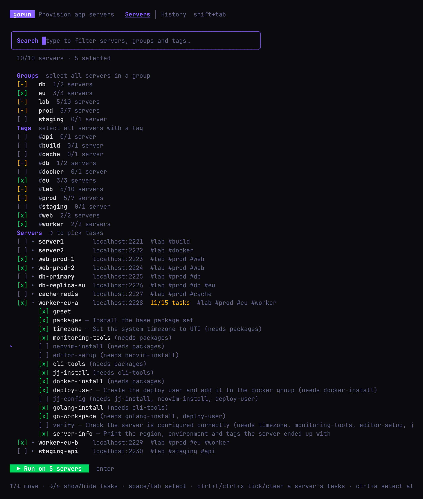
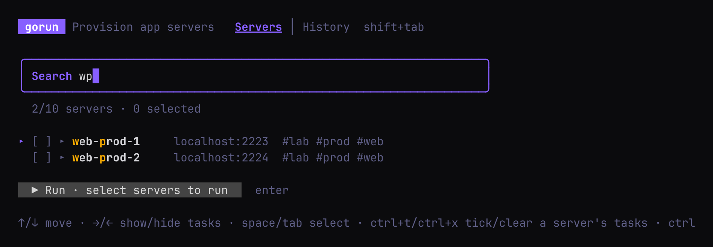
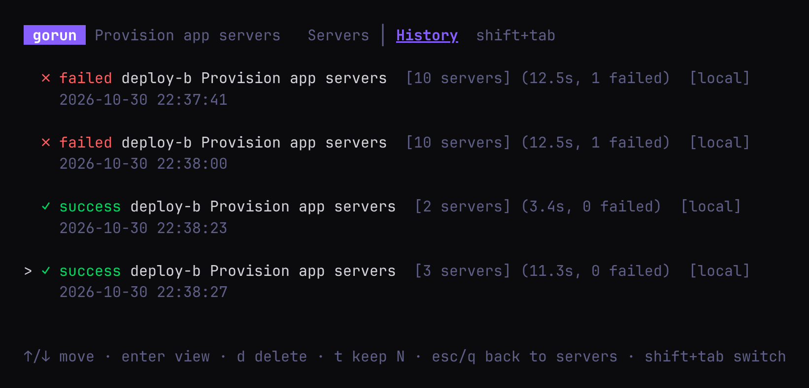
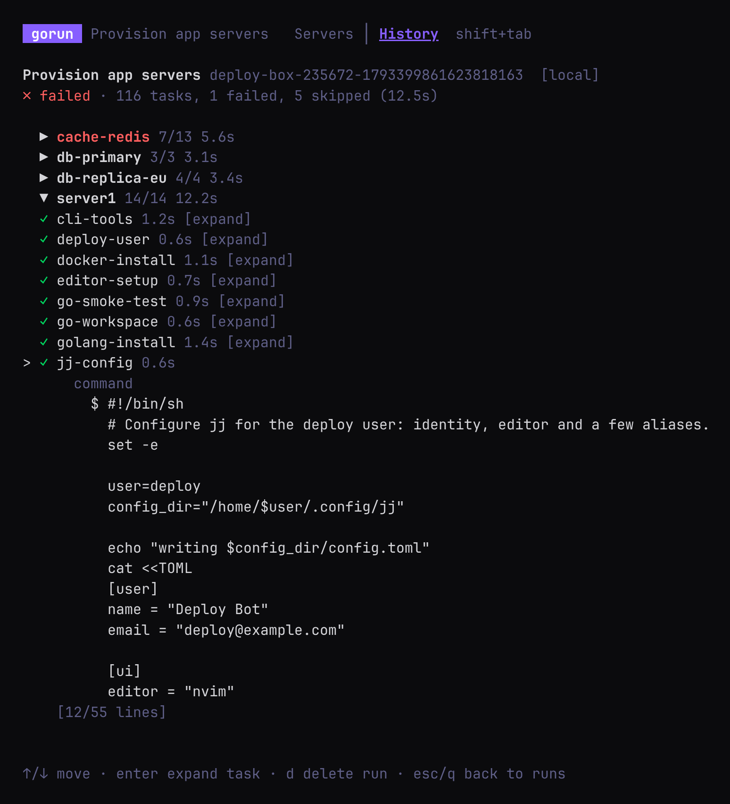

# Gorun

**Run plain shell commands on a pile of servers, in parallel, and watch it happen.**

One Go binary, one TOML file and SSH. No agent on the servers, no Python on your machine, and
nothing left behind beyond what your commands did. Pick the servers and tasks to run in an
interactive picker, follow every server's progress live, and look back at any run later.


## Contents

- [Quick start](#quick-start)
- [Why gorun](#why-gorun)
- [Installation](#installation)
- [The Gorunfile](#the-gorunfile)
  - [Tasks](#tasks) · [Servers and SSH](#servers-and-ssh) · [Bundles](#bundles) · [Server groups and tags](#server-groups-and-tags) · [How a server's settings are worked out](#how-a-servers-settings-are-worked-out)
  - [Timeouts](#timeouts) · [Retries](#retries) · [Descriptions and rerun safety](#descriptions-and-rerun-safety)
- [Running](#running)
  - [The server picker](#the-server-picker)
  - [Watching a run](#watching-a-run)
  - [Running without the picker](#running-without-the-picker)
  - [Choosing servers and tasks on the command line](#choosing-servers-and-tasks-on-the-command-line)
  - [Inspecting a Gorunfile](#inspecting-a-gorunfile)
- [History](#history)
- [Web UI](#web-ui)
- [Logs and OpenTelemetry](#logs-and-opentelemetry)
- [Events (NATS)](#events-nats)
- [Using gorun as a library](#using-gorun-as-a-library)
- [Shell completion](#shell-completion)
- [Reference](#reference)
  - [Command line](#command-line) · [Environment variables](#environment-variables) · [Gorunfile keys](#gorunfile-keys)
- [Development](#development)

## Quick start

```bash
# install (see below for other ways)
curl -fsSL https://raw.githubusercontent.com/jenmud/gorun/master/scripts/install.sh | sh

# write a starting Gorunfile; it runs as-is on this machine
gorun -dump > Gorunfile

# pick what to run (space selects, → shows a server's tasks, enter runs)
gorun Gorunfile

# or run everything straight away, without the picker
gorun Gorunfile --run
```

The generated Gorunfile has two tasks, a bundle, a server group and one local host, and every
other option is written out in comments next to where it goes. To run on a real server, add a
host with an `ssh` table (without one, a host runs on your own machine):

```toml
[servers.hosts.web-01]
hostname = "web-01.example.com"
    [servers.hosts.web-01.ssh]
    username = "deploy"
    identityfile = "~/.ssh/id_ed25519"
```

Then `gorun Gorunfile --list-servers` shows what each server will run, and `gorun Gorunfile`
lets you pick it.

## Why gorun

Gorun is for when you know exactly which commands you want to run, and you just need them run
on a pile of machines, without packaging every command into a playbook, role, collection and
module first.

**What it is good at**

- **Plain commands, all the way down.** A task is a shell command. Gorun shows you that command,
  runs it over SSH (or locally), and captures stdout, stderr and the exit code. When something
  breaks you can copy the command, ssh into the box and reproduce it by hand.
- **Parallel across servers, ordered within one.** Every selected server runs at the same time
  (or N at a time with `max_parallel`). On each server, tasks run in dependency order; if one
  fails, the rest of that server's tasks are skipped and the other servers carry on.
- **Nothing runs by accident.** In a terminal, every run starts in a picker where you choose the
  servers, and even individual tasks, before anything happens (`--run` skips it on purpose). Every task has a timeout (30 minutes by
  default), so a hung command can't hold the run hostage.
- **A task library, not copy-paste.** Define a task once, give it `depends_on`, group tasks into
  **bundles**, and share settings between servers with **server groups** and **tags**. Typos,
  unknown names and dependency cycles are reported before anything runs.
- **Readable templating and file copies.** Go templates get you per-host commands and config files
  (`{{.Name}}`, `{{.Hostname}}`, `{{index .EnvVars "REGION"}}`), and copies push files, rendered
  templates or whole directories.
- **A memory and a paper trail.** Every run is stored in SQLite and can be browsed from the
  picker's History tab, `gorun -history` or the web UI. Logs go to a file, events can go out over
  NATS, and the instrumented build adds OpenTelemetry.
- **Small enough to embed.** The CLI is a thin layer over the `gorun` Go package.

**What it is not great at**

- **Configuration management.** Gorun has no facts, drift detection, check mode or diff;
  idempotence is whatever your commands make it. For enforcing state forever, use Ansible, Puppet,
  Salt, Nix or similar. Gorun is the runner, not the police.
- **Modules.** There are no `package`/`service`/`user` abstractions; the shell is the abstraction.
- **Dynamic inventories.** Servers live in the Gorunfile. Generate the file if your machines move
  around.
- **Fancy orchestration.** No rolling batches, health checks or dry runs. Retries are per task,
  with a fixed delay. Tasks on one server run one after another.
- **Secrets management.** SSH keys, optional passwords and env vars, not a vault. Keep secrets out
  of the Gorunfile.
- **Non-SSH targets.** SSH and a local shell only. Local tasks assume a POSIX-ish `sh`.
- **Host-key verification.** The SSH client skips it, so use gorun on networks you trust.
- **Big transfers.** Copies read each file into memory: fine for configs and scripts, not for
  rsync-sized trees.
- **Maturity.** Gorun is young and small. It is a small, sharp knife.

## Installation

There are two builds: the default one adds [OpenTelemetry](#logs-and-opentelemetry) support,
which does nothing until you set an `OTEL_*` endpoint, and the standard build leaves it out.

**Quick install.** The script installs the instrumented build as `gorun` (prebuilt for Linux
x86-64; elsewhere it falls back to building from source). Set `INSTALL_VARIANTS=1` for the
standard build:

```bash
curl -fsSL https://raw.githubusercontent.com/jenmud/gorun/master/scripts/install.sh | sh
curl -fsSL https://raw.githubusercontent.com/jenmud/gorun/master/scripts/install.sh | INSTALL_VARIANTS=1 sh
```

**Manual install.** Download a binary from the [releases](https://github.com/jenmud/gorun/releases),
or build from source:

```bash
go build -o gorun ./cmd
mv gorun /usr/local/bin/
```

## The Gorunfile

A Gorunfile is TOML. It has a **task library** (`[tasks.<name>]`), optional **bundles** (named
task lists) and **server groups** (shared settings), and the **servers** that pick tasks by name.
Servers are configured under `[servers.hosts.<name>]`, so the config calls each one a *host*; the
flags and this README say *server*, and mean the same thing.

```toml
title = "Provision app servers"
max_parallel = 4                  # hosts at once; 0 (default) means all of them

[tasks.packages]
cmd_file = "./scripts/packages.sh"
description = "Install the base package set"
sudo = true

[tasks.timezone]
cmd = "cp /usr/share/zoneinfo/UTC /etc/localtime"
sudo = true
depends_on = ["packages"]         # always pulled in and run first

[tasks.monitoring-tools]
cmd = "apk add --no-cache htop"
sudo = true

[tasks.app-files]
[[tasks.app-files.copy]]
src = "./files/app"               # a local directory, copied recursively
dst = "/opt/app"

[bundles.baseline]
tasks = ["timezone", "monitoring-tools"]

[server_groups.prod]
tags = ["prod"]
envvars = { APP_ENV = "production" }
    [server_groups.prod.ssh]      # shared login for every host in the group
    username = "deploy"
    identityfile = "~/.ssh/id_ed25519"

[servers]
tasks = ["@baseline"]             # what every host runs, unless it says otherwise

[servers.hosts.web-01]
hostname = "web-01.example.com"
groups = ["prod"]
tags = ["web"]
add_tasks = ["app-files"]         # on top of the list above
```

Relative paths (`cmd_file`, copy sources, `identityfile`, ...) are relative to the Gorunfile, so
gorun can be run from anywhere; a leading `~/` is your home directory. Unknown keys, such as a
typo like `cmd_flie`, are errors rather than silently ignored. [`example/Gorunfile`](example/Gorunfile)
is a complete, commented example, and every key is listed in the [reference](#gorunfile-keys).

### Tasks

A task has one command source, file copies, or both (copies run first):

| Key | What it runs |
|---|---|
| `cmd` | a shell command |
| `cmd_file` | a local script, sent to the server |
| `cmd_template` | a Go template rendered for each server, then run |
| `cmd_template_file` | the same, from a local file |

Templates see the server: `{{.Name}}`, `{{.Hostname}}`, `{{.SSH.Port}}`, `{{.Tags}}` and
`{{index .EnvVars "REGION"}}` (including what its groups set).

```toml
[tasks.greet]
cmd_template = "echo 'hello from {{.Name}} on {{.Hostname}}'"

[tasks.nginx-config]
cmd = "mv /tmp/site.conf /etc/nginx/conf.d/site.conf && nginx -s reload"
sudo = true                                   # for the command; copies run as the login user
[[tasks.nginx-config.copy]]
src_template = "./templates/site.conf.tmpl"   # rendered with the server, like cmd_template
dst = "/tmp/site.conf"

[tasks.app-files]
[[tasks.app-files.copy]]
src = "./files/app"      # a directory is copied recursively, like scp -r
dst = "/opt/app"         # /opt/app gets the contents of ./files/app
```

- **Copies:** `src` (a local file or directory), `src_template` (a template file) or `content`
  (inline text), to `dst` (the target path); with `src` you can give `dir` instead (a target
  directory, keeping the file's name). Copies run as the login user, not with `sudo`, so copy to a
  writable place and move the file in the command if it needs root. Files are written with mode
  `0644` (directory copies keep the local permissions); existing files are overwritten.
  A directory copy creates the target directory and its parents, leaves files that aren't in
  `src` alone, and follows symlinks; for a single file, the parent directory must already exist.
- **Options:** `sudo` (runs the command with `sudo -n`, so the login user needs passwordless
  sudo), `shell` (local hosts only, default `sh -c`; over SSH the command runs in the remote login
  shell, or `sh -c` with `sudo`), `envvars`, `log_level`, plus [`timeout`](#timeouts),
  [`retries`](#retries) and the [`description`/`details`/`rerun`](#descriptions-and-rerun-safety)
  hints.
- **Dependencies:** `depends_on` tasks always run first, once, even if a server doesn't list them.
  Cycles are reported before anything runs.
- **Env vars:** a task's own `envvars` win over its server's (and groups'), which win over the
  global `envvars`; write keys in upper case, as they are upper-cased when set. Over SSH they are
  sent with the session, which the server's sshd only accepts for names in its `AcceptEnv`, so
  rely on them for local hosts, or render values into the command with `cmd_template`
  (`{{index .EnvVars "REGION"}}`).

### Servers and SSH

`[servers] tasks` is the list every host runs. A host (`[servers.hosts.<name>]`) can replace it
with its own `tasks`, or adjust it with `add_tasks` and `skip_tasks`.

> [!IMPORTANT]
> A host runs over SSH only when it has SSH settings, in its own `ssh` table or from a
> [server group](#server-groups-and-tags). A host with just a `hostname` runs its tasks **on your
> own machine**.

```toml
[servers.hosts.db-01]
hostname = "db-01.internal"
    [servers.hosts.db-01.ssh]
    username = "root"
    port = 22
    identityfile = "~/.ssh/id_ed25519"   # or password = "...", but prefer keys
```

Settings missing from the Gorunfile (`username`, `port`, `identityfile`, and the real hostname of
an alias) are filled in from your SSH config: `config_file` if set, otherwise `~/.ssh/config`
when it exists. Share logins through a server group; of the global `[ssh]` table only
`config_file` is used, and setting it gives **every** host SSH settings, so hosts without their
own then run over SSH too.

### Bundles

A bundle names a list of tasks. Use it as `@name` anywhere a task list is accepted: `[servers]
tasks`, a host's `tasks`, `add_tasks` and `skip_tasks`, a group's `tasks`, another bundle, and
`--task @name` on the command line.

```toml
[bundles.baseline]
description = "Minimal setup every box gets"   # shown by --list-bundles
tasks = ["timezone", "monitoring-tools"]

[bundles.standard]
tasks = ["greet", "@baseline", "@devtools", "verify"]   # bundles can include bundles
```

A bundle expands to its tasks in order, repeats are dropped, and each task's `depends_on` still
applies. An unknown name or a bundle that includes itself is an error.

### Server groups and tags

A **server group** holds settings shared by the hosts that join it with `groups = [...]`:
`tags`, `tasks`, `envvars`, `log_level` and an `ssh` table. **Tags** label hosts for selection
(`--tag web`, or in the picker); a host's tags are its own plus its groups'.

```toml
[server_groups.lab]                # every machine in the lab shares one login
tags = ["lab"]
    [server_groups.lab.ssh]
    username = "testuser"
    identityfile = "./ssh-keys/id_ecdsa"

[server_groups.eu]
tags = ["eu"]
tasks = ["server-info"]            # added to what eu hosts run
envvars = { REGION = "eu-west-1" }

[servers.hosts.worker-eu-b]
hostname = "10.0.4.12"
groups = ["lab", "eu"]
tags = ["worker"]
envvars = { REGION = "eu-central-1" }   # the host wins over the group
    [servers.hosts.worker-eu-b.ssh]
    port = 2229                         # the rest comes from the lab group
```

### How a server's settings are worked out

Settings are layered: the global settings, then each group **in the order the host lists them**,
then the host itself. A later layer wins.

| Setting | How layers combine |
|---|---|
| `log_level`, each `ssh` field | the last one set wins |
| `envvars` | merged by key, the last one wins (a task's own `envvars` still win) |
| `tags` | all of them, without repeats |
| tasks | see below |

A host's task list is built like this:

1. If the host sets `tasks`, that list is used and the global and group lists are ignored.
2. Otherwise it is `[servers] tasks`, followed by each group's `tasks`, in order.
3. `add_tasks` are appended and `skip_tasks` removed. Bundles are expanded first, so
   `skip_tasks = ["@baseline"]` skips the whole bundle. Repeats are dropped, keeping the first.

Mistakes are errors: an unknown group or bundle; an unknown task in a bundle, a group, `add_tasks`
or `skip_tasks` (even in a bundle or group no host uses); and skipping a task that another of the
host's tasks depends on, which would only be pulled straight back in. An unknown task in
`[servers] tasks` or a host's `tasks` is reported for the hosts left after the command-line
filters, so `--server` can still run the others while one host has a typo.
`gorun Gorunfile --list-servers` shows the result for every host.

### Timeouts

Every task is limited to **30 minutes** unless it sets `timeout` (any Go duration: `90s`, `10m`,
`2h`):

```toml
[tasks.migrate]
cmd = "docker compose run --rm migrate"
timeout = "45m"
```

The timeout covers the task's file copies and its command. A timed-out task fails with exit code
**124** (like `timeout(1)`), the rest of that server's tasks are skipped, and the reason
(`task "migrate" timed out after 45m0s`) shows in the TUI, the plain output and the history.
Local tasks are killed with their whole process group; SSH tasks get `SIGTERM` and the connection
is closed. Zero or unset means the default; negative values are rejected. There is no "run forever"
setting; give a long task a long timeout.

### Retries

Retries are **off** unless a task sets `retries`, the number of extra attempts after a failure:

```toml
[tasks.packages]
cmd_file = "./scripts/packages.sh"
retries = 2          # up to three attempts
retry_delay = "1s"   # wait before each retry; default 50ms, "0s" retries immediately
```

- Each attempt gets a fresh timeout and starts with empty output. The TUI shows `retry 2/3` while
  a retry runs, and plain output prints `retrying (attempt 2/3)`.
- A task that eventually succeeds isn't a failure; one that runs out of attempts counts as one
  failed task.
- Timeouts and cancelled runs are never retried.
- A task marked `rerun = "unsafe"` isn't retried either, unless it also sets `retry_unsafe = true`,
  for failures you know are safe to repeat.

### Descriptions and rerun safety

```toml
[tasks.migrate]
cmd = "docker compose run --rm migrate"
description = "Apply database migrations"     # one line, in lists, the picker and the TUI
details = "Runs every pending migration and records the applied version."   # when expanded
rerun = "safe"
```

`rerun` says whether running the task again is harmless: `safe` (it only converges, like installing
a package), `unsafe` (it may change the server again or fail, like appending a line or rotating a
key) or unset (unknown). Unsafe tasks are marked ⚠ in lists and the TUI. It's documentation, not a
guard: gorun still runs them, but won't [retry](#retries) them automatically.

## Running

```bash
gorun Gorunfile                    # pick servers and tasks, then run
gorun Gorunfile -v                 # the same, with every task listed while it runs
gorun Gorunfile --run              # run everything the filters select, no picker (-r)
gorun Gorunfile -r --plain         # plain log lines instead of the TUI, e.g. for CI
gorun Gorunfile -r -parallel 4     # at most 4 servers at a time
```

### The server picker

Unless you pass `--run`, every run starts in the picker. **Nothing runs until you select it:**
pressing enter with nothing selected does nothing.



- **Servers** are listed with their address and tags. Select them with space (or tab, which also
  moves down) or a click.
- **Groups** and **tags** above them select all their servers at once. Their checkbox shows `[x]`
  when all of their servers are selected, `[-]` when some are, and `[ ]` when none are.
- **→ expands a server** to list the tasks it would run, dependencies included, and **←**
  collapses it. Untick a task to leave it out of the run; changing a server's tasks selects that
  server. Choices follow `depends_on`: unticking a task also unticks the tasks that need it, and
  ticking a task ticks what it needs, so a selected server runs exactly its ticked tasks. The
  server's row shows e.g. `11/15 tasks`.
- **Typing filters** servers (by name, then hostname, then tags), groups and tags with a fuzzy
  match: `wp` finds `web-prod-1` and `web-prod-2`.



The picker only offers the servers left after `--server`, `--tag`, `--group` and
`--exclude-server`, with the tasks left after `--task`, so the command line and the picker
combine: `gorun Gorunfile --tag prod --task @baseline` opens a picker with just that.

| Key | Action |
|---|---|
| type, backspace, ctrl+w, ctrl+u | edit the filter |
| ↑/↓, ctrl+p/ctrl+n, mouse wheel | move |
| space, click | select or deselect the server, group, tag or task under the cursor |
| tab | the same, then move down |
| → / ← (or click ▸) | show / hide a server's tasks |
| ctrl+t / ctrl+x | tick / clear all of the current server's tasks |
| ctrl+a | select every server shown (again to deselect them) |
| ctrl+d | clear the whole selection, including task choices |
| shift+tab (or click the tab) | switch between **Servers** and [**History**](#history) |
| enter, ctrl+r, click **▶ Run** | run the selection |
| esc | clear the filter, then quit |
| ctrl+c | quit without running anything |

### Watching a run

The compact view shows a progress bar per server and what each one is doing (the screenshot at
the [top](#gorun)). Press **v** (or start with `-v`) for the verbose view, which lists every task:


Move with ↑/↓ and press **enter** to open a task's command output inline. The view stays open after
the run, so you can browse the output before quitting with **q**:


**Failures** always show in a red box with the reason, exit code and the end of stderr, even in the
compact view. The rest of that server's tasks are skipped, the other servers carry on, and gorun
exits with status 1:


In the verbose view the failed task is marked ✗ and opens automatically:


### Running without the picker

`--run` (`-r`) skips the picker and runs everything the filters select. Scripts, CI jobs and cron
need it: without a terminal there is no picker, so gorun exits with an error rather than run
anything unasked.

When stdout isn't a terminal, or with `--plain`, gorun prints plain lines instead of the TUI: the
plan, then one line per finished task, with the end of stderr for failures (`-v` prints every
task's output).

```bash
gorun Gorunfile -r --plain --tag prod
```

### Choosing servers and tasks on the command line

```bash
gorun Gorunfile --server web-prod-1 --server db-primary   # these servers
gorun Gorunfile --server 'web-*' --exclude-server 'web-canary-*'
gorun Gorunfile --tag prod                                 # servers tagged prod
gorun Gorunfile --tag prod --tag web --group eu            # all of these
gorun Gorunfile --task verify                              # just this task (and its dependencies)
gorun Gorunfile --task @baseline                           # a bundle
gorun Gorunfile --task 'deploy-*'                          # every matching task
```

- Repeated `--server` flags add servers and `--exclude-server` removes them. Repeated `--tag` and
  `--group` flags must all match.
- `--server`, `--exclude-server` and `--task` take globs (`*`, `?`, `[a-z]`); quote them so the
  shell leaves them alone. A glob that matches nothing is an error, except for `--exclude-server`.
- A name, tag or group that doesn't exist is an error, with a "did you mean" hint when one is
  close.

> [!CAUTION]
> `--task X` runs X on **every** selected server, whether or not that server normally runs it, and
> ignores `skip_tasks`. Combine it with `--server`, `--tag` or `--group` to aim it.

### Inspecting a Gorunfile

```bash
gorun Gorunfile --list-servers    # every server with its groups, tags and resolved task list
gorun Gorunfile --list-tasks      # the task library as a dependency tree
gorun Gorunfile --list-tags       # each tag and the servers that have it
gorun Gorunfile --list-bundles    # each bundle as a tree, and what it expands to
```

The server and task filters apply to `--list-servers`, `--list-tasks` and `--list-tags`, so
`gorun Gorunfile --list-servers --tag prod` shows exactly what a `--tag prod` run would do:

```
web-prod-1 (localhost:2223)
    groups: lab, prod
    tags: lab, prod, web
    ├── greet
    ├── packages (retries: 1)
    ├── timezone
    ...
```

## History

Every run is recorded in a SQLite database: the servers, every task's command, stdout, stderr,
exit code and duration, and whether the run succeeded. The database is `GORUN_DB_PATH` if that
file exists, otherwise `./gorun.db` if there is one, otherwise `~/.gorun/gorun.db`.

Press **shift+tab** in the picker for the **History** tab (or run `gorun -history`). Each row shows
the result, the start of the run ID (which begins with the name of the machine gorun ran on), the
Gorunfile's title, the number of servers, the duration and failures, and when it started:



Press **enter** to open a run, then expand a server and its tasks to see exactly what ran:
commands are shown as written, line by line, with their output.



| Key | Action |
|---|---|
| ↑/↓ | move |
| enter | open a run; expand a server or task |
| d | delete the run |
| t | keep only the N most recent runs (asks for N) |
| esc, q | back: from a run to the runs list, and from the runs list to the picker's servers |

The web UI shows the history at `http://localhost:8080/runs`. It uses `GORUN_DB_PATH` as given
(even before the file exists) or `~/.gorun/gorun.db`, without the `./gorun.db` fallback, so set
`GORUN_DB_PATH` if you want both to show the same database.

## Web UI

`gorun -web` starts a web server (`GORUN_ADDRESS`, default `:8080`) with a live dashboard of
running gorun processes and the run history. The live dashboard follows runs through
[NATS](#events-nats). It is built with [templ](https://templ.guide), [Datastar](https://data-star.dev)
and Tailwind CSS.


Each gorun process is a card with its title, progress and status, and failed runs show their
failure box. Click a card for the per-server, per-task detail:


Successful runs disappear on their own; **Clear finished** removes failed ones. `/runs` lists the
history from the database, with a page per run, a delete button and "Keep 10 most recent".

## Logs and OpenTelemetry

gorun's own log messages go to `~/.gorun/gorun.log` (or `GORUN_LOG_FILE`), not the terminal. The
file is appended to on every run, and server and task lines carry the run's `gorun_uuid`. When a
plain-mode run fails, the error message includes the path.

The **instrumented build** (the default from the install script) adds OpenTelemetry traces,
metrics and logs, but only exports what you configure. With no OTLP endpoint or exporter set,
everything is off, so a run without a collector never tries to connect anywhere:

```bash
OTEL_EXPORTER_OTLP_ENDPOINT=http://localhost:4318 gorun Gorunfile           # every signal
OTEL_EXPORTER_OTLP_TRACES_ENDPOINT=http://collector:4318/v1/traces gorun Gorunfile   # traces only
OTEL_TRACES_EXPORTER=console gorun Gorunfile -r --plain                     # spans to the log file
```

Each signal is configured on its own. `GORUN_NAME` is the service name unless `OTEL_SERVICE_NAME`
is set. The standard build has no OpenTelemetry.

## Events (NATS)

When a [NATS](https://nats.io) server is reachable, gorun publishes each run's events to it, as
JSON on `gorun.events` (or `GORUN_EVENT_TOPIC`); the web UI's live dashboard uses them. Without
NATS gorun runs as normal. Set `GORUN_SKIP_NATS=1` to not try at all.

```bash
make up    # starts the example lab, including a NATS server (see example/docker-compose.yml)
```

Every event has a `type` and the run's `gorun_uuid`:

| Type | Sent | Fields |
|---|---|---|
| `process_started` | when a run starts | `title`, `servers`, `started_at`, `hostname`, `pid` |
| `plan` | per server, before it starts | `server`, `address`, `tasks`, `task_meta` |
| `task` | every task state change | `server`, `task`, `state`, `command`, `stdout`, `stderr`, `exit_code`, `duration`, `attempt`, `attempts` |
| `server_error` | a server couldn't run (e.g. SSH failed) | `server` |
| `process_finished` | when the run ends | `success`, `duration`, `total_tasks`, `failed`, `skipped`, `finished_at` |

`command` is the command as written, with templates rendered. Events are published synchronously,
so short runs don't lose any. The connection is configured with the `GORUN_NATS_CLIENT_*`
[variables](#environment-variables).

## Using gorun as a library

The CLI and TUI live under `cmd`; the rest is the `gorun` package. Load a Gorunfile, select
servers and tasks the way the command-line flags do, and get every event as it happens:

```go
f, err := os.Open("example/Gorunfile")
if err != nil {
	log.Fatal(err)
}
defer f.Close()

var cfg gorun.Config
if err := cfg.Load(f); err != nil {
	log.Fatal(err)
}
cfg.ResolvePaths(filepath.Dir(f.Name())) // relative paths are relative to the Gorunfile

// the same as `--tag web --task @baseline`
servers, err := cfg.SelectServers(gorun.ServerFilter{Tags: []string{"web"}})
if err != nil {
	log.Fatal(err)
}
tasks, err := cfg.ExpandTaskPatterns("@baseline")
if err != nil {
	log.Fatal(err)
}
for i := range servers {
	servers[i].TaskNames = tasks
}

cfg.OnEvent = func(event any) {
	if ev, ok := event.(gorun.TaskEvent); ok && ev.State != gorun.TaskRunning {
		fmt.Printf("%s: %s exit %d\n", ev.Server, ev.Task, ev.ExitCode)
	}
}

if err := cfg.Run(context.Background(), servers...); err != nil {
	log.Fatal(err)
}
```

`ServersPipeline` returns every server's resolved task list, and `RunTask` runs a single task
(with its dependencies) on some or all servers.

## Shell completion

Bash can complete gorun's flags, Gorunfile paths, and the task, bundle, server, tag and group
names from a Gorunfile. Add this to `~/.bashrc`:

```bash
_gorun_complete() {
    local cur prev file word i
    cur=${COMP_WORDS[COMP_CWORD]}
    prev=${COMP_WORDS[COMP_CWORD-1]}

    # Find the Gorunfile argument, skipping flags and their values.
    for ((i = 1; i < COMP_CWORD; i++)); do
        word=${COMP_WORDS[i]}
        case $word in
            -task|--task|-server|--server|-exclude-server|--exclude-server|-tag|--tag|-group|--group|-parallel|--parallel) ((i++)) ;;
            -*) ;;
            *) file=$word; break ;;
        esac
    done

    # Stock bash splits words at "@", so "--task @ba" arrives as "--task" "@" "ba".
    if [[ $prev == @ && ( ${COMP_WORDS[COMP_CWORD-2]} == -task || ${COMP_WORDS[COMP_CWORD-2]} == --task ) ]]; then
        COMPREPLY=($(compgen -W "$(gorun -complete tasks "$file" 2>/dev/null | sed -n 's/^@//p')" -- "$cur"))
        return
    fi

    case $prev in
        -task|--task)
            COMPREPLY=($(compgen -W "$(gorun -complete tasks "$file" 2>/dev/null)" -- "$cur"))
            return
            ;;
        -server|--server|-exclude-server|--exclude-server)
            COMPREPLY=($(compgen -W "$(gorun -complete servers "$file" 2>/dev/null)" -- "$cur"))
            return
            ;;
        -tag|--tag)
            COMPREPLY=($(compgen -W "$(gorun -complete tags "$file" 2>/dev/null)" -- "$cur"))
            return
            ;;
        -group|--group)
            COMPREPLY=($(compgen -W "$(gorun -complete groups "$file" 2>/dev/null)" -- "$cur"))
            return
            ;;
    esac

    if [[ $cur == -* ]]; then
        COMPREPLY=($(compgen -W "-v -plain -run -r -task -server -exclude-server -tag -group -parallel -list-tasks -list-servers -list-tags -list-bundles -dump -version -web -history -h --task --server --exclude-server --tag --group --parallel --run --plain --list-tasks --list-servers --list-tags --list-bundles --dump --version --web --history --help" -- "$cur"))
    else
        COMPREPLY=($(compgen -f -- "$cur"))
    fi
}

complete -o filenames -F _gorun_complete gorun
```

`gorun -complete <kind> [Gorunfile]` prints the names for `tasks` (including `@bundles`),
`servers`, `tags` or `groups`, using `./Gorunfile` when no file is given.

## Reference

### Command line

```
gorun [options] <Gorunfile>
```

Flags take one or two dashes and can go before or after the Gorunfile, except `-version`,
`-dump` and `-complete`, which must come first.

| Flag | Description |
|---|---|
| `-run`, `-r` | run without the picker (needed when there is no terminal) |
| `-v` | verbose: list every task and its output |
| `-plain` | plain lines instead of the TUI (the default when stdout isn't a terminal) |
| `-server <name>` | only this server; repeatable, globs allowed |
| `-exclude-server <name>` | not this server; repeatable, globs allowed |
| `-tag <tag>` | only servers with this tag; repeatable, all must match |
| `-group <group>` | only servers in this group; repeatable, all must match |
| `-task <name>` | only this task (with its dependencies); repeatable, globs and `@bundles` allowed |
| `-parallel <n>` | at most n servers at a time; `0` means all (overrides `max_parallel`) |
| `-list-servers` | list servers with their groups, tags and task lists |
| `-list-tasks` | list tasks as a dependency tree |
| `-list-tags` | list tags and their servers |
| `-list-bundles` | list bundles and what they expand to |
| `-dump` | print a starting Gorunfile |
| `-history` | browse past runs |
| `-web` | start the web UI |
| `-complete <kind>` | print shell completion candidates |
| `-version` | print the version |

### Environment variables

They can also be set in a `.env` file in the current directory, which never overrides variables
already set.

| Variable | Default | Description |
|---|---|---|
| `GORUN_NAME` | `gorun` | name for OpenTelemetry and NATS |
| `GORUN_DB_PATH` | `~/.gorun/gorun.db` | history database (see [History](#history) for how it is found) |
| `GORUN_LOG_FILE` | `~/.gorun/gorun.log` | log file |
| `GORUN_ADDRESS` | `:8080` | web UI listen address |
| `GORUN_EVENT_TOPIC` | `gorun.events` | NATS topic for events |
| `GORUN_SKIP_NATS` | unset | set to skip NATS |
| `GORUN_NATS_CLIENT_URL` | `nats://127.0.0.1:4222` | NATS server |
| `GORUN_NATS_CLIENT_NAME` | `GORUN_NAME` | NATS client name |
| `GORUN_NATS_CLIENT_ALLOW_RECONNECT` | `true` | reconnect automatically |
| `GORUN_NATS_CLIENT_RECONNECT_WAIT` | NATS default | wait between reconnects, e.g. `2s` |
| `GORUN_NATS_CLIENT_TIMEOUT` | NATS default | connection timeout, e.g. `5s` |

The instrumented build also honours the standard `OTEL_*` variables (see
[Logs and OpenTelemetry](#logs-and-opentelemetry)).

### Gorunfile keys

`gorun -dump` prints a Gorunfile that documents every one of these in place.

**Top level**

| Key | Description |
|---|---|
| `title` | shown in the picker, the TUI and the history |
| `log_level` | `debug`, `info`, `warn` or `error`; servers and tasks inherit it |
| `max_parallel` | servers at once; `0` (default) means all |
| `envvars` | env vars for every task |
| `[ssh]` | only `config_file` (or `config`) is used: the SSH config every host reads (and it makes every host use SSH) |

**`[tasks.<name>]`**

| Key | Description |
|---|---|
| `cmd`, `cmd_file`, `cmd_template`, `cmd_template_file` | the command (pick one) |
| `copy` (also `copies`, `upload`, `files`) | file copies: `src`, `src_template` or `content`; `dst` (or `dir` with `src`) |
| `depends_on` | tasks that must run first |
| `sudo` | run with `sudo -n` |
| `shell` | shell for local hosts (default `sh -c`) |
| `envvars` | env vars for this task |
| `log_level` | log level for this task |
| `timeout` | Go duration, default `30m` |
| `retries`, `retry_delay`, `retry_unsafe` | [retries](#retries) |
| `description`, `details`, `rerun` | [descriptions and rerun safety](#descriptions-and-rerun-safety) |

**`[bundles.<name>]`**: `tasks` (task names and `@bundles`) and `description`.

**`[server_groups.<name>]`**: `tags`, `tasks`, `envvars`, `log_level` and an `ssh` table.

**`[servers]`**: `tasks`, the list every host runs.

**`[servers.hosts.<name>]`**

| Key | Description |
|---|---|
| `hostname` | address to connect to (the name is used when unset) |
| `groups` | server groups to join, in order |
| `tags` | tags for selection |
| `tasks` | replaces the global and group task lists |
| `add_tasks`, `skip_tasks` | append to / remove from the task list |
| `envvars` | env vars for every task on this host |
| `log_level` | log level for this host |
| `ssh` | `username`, `port`, `identityfile`, `password`, `config_file` |

## Development

```bash
make test     # run the tests
make build    # build the standard and instrumented binaries
make up       # start the example lab: ten SSH servers and NATS (example/docker-compose.yml)
make run      # run example/Gorunfile against the lab
make web-dev  # the web UI with live reload
```

The terminal screenshots in this README are generated by
[`docs/screenshots/capture.sh`](docs/screenshots/capture.sh). It drives gorun in tmux (the picker
against `example/Gorunfile`, the runs and history against a demo Gorunfile that only echoes and
sleeps) and renders the screens with headless Chromium. Run it again after changing the UI. The
web dashboard screenshots are taken by hand.
