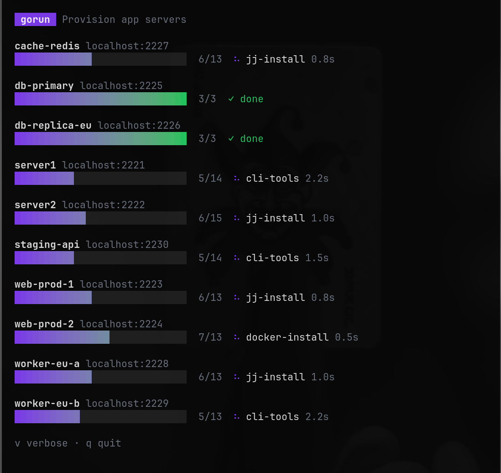
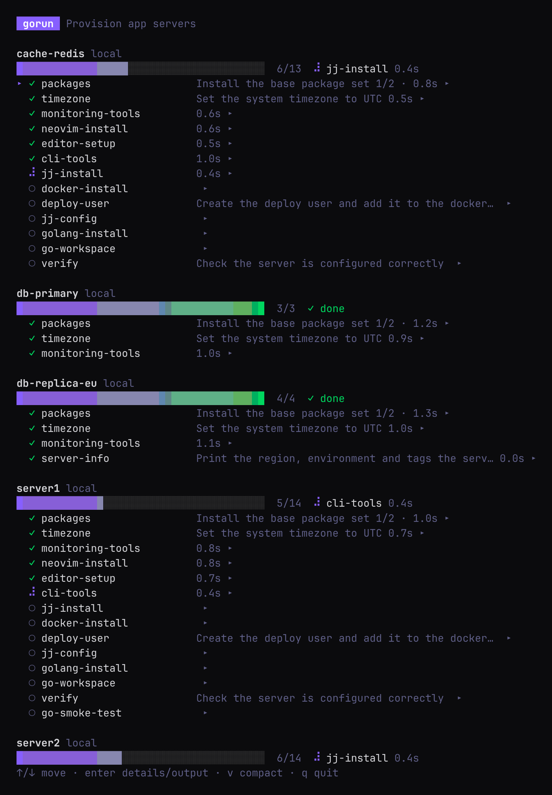
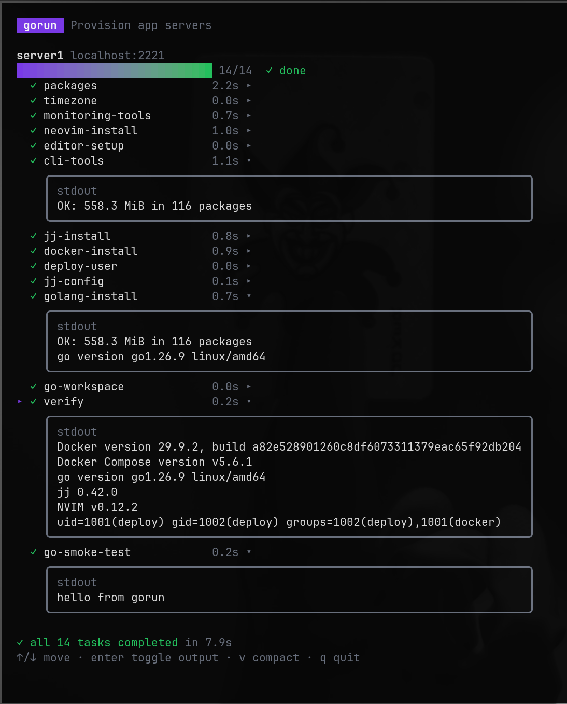
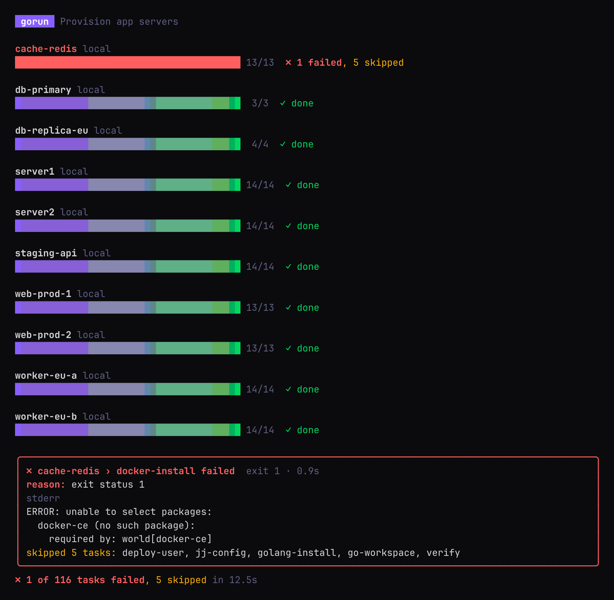
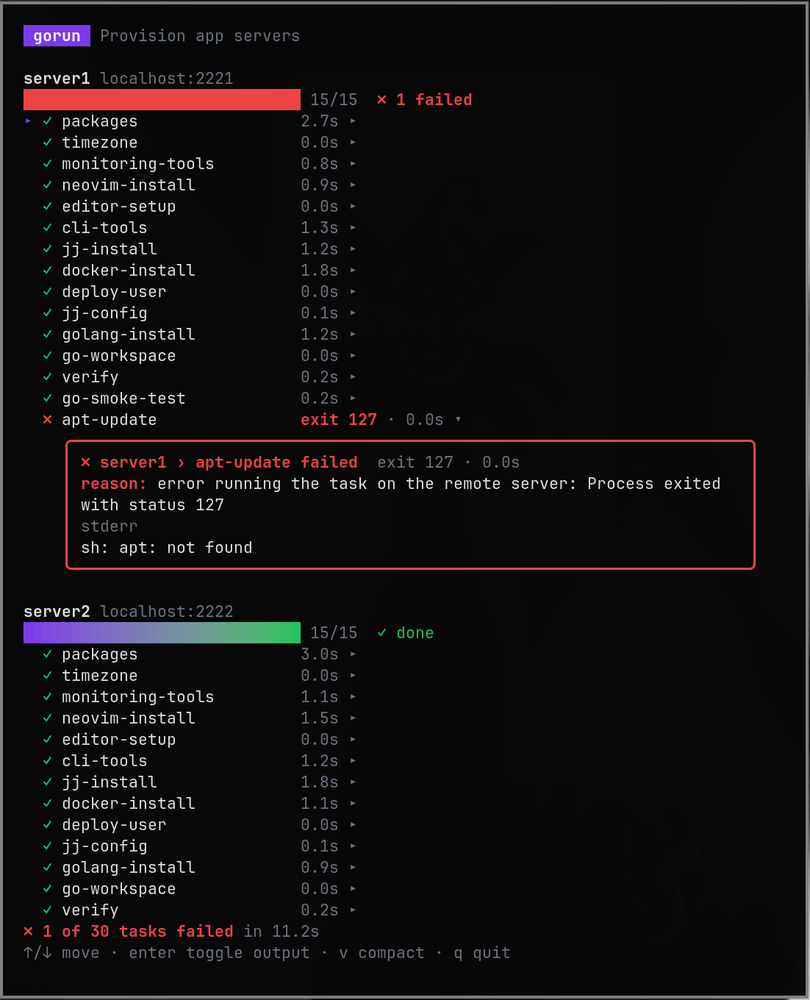
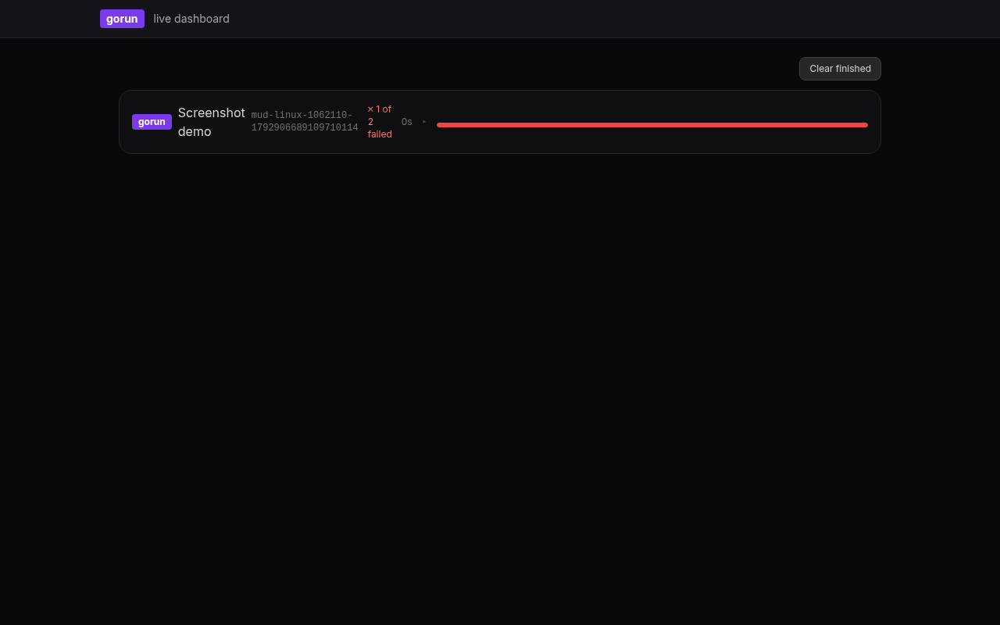
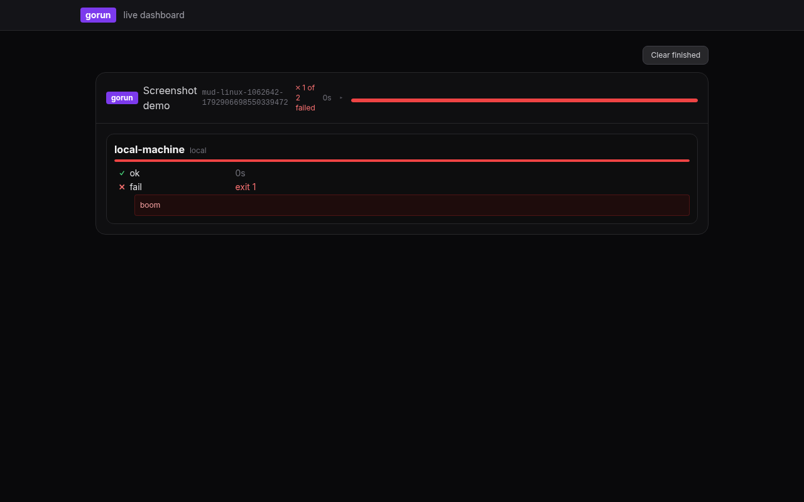

# Gorun

Gorun is a tool for running tasks on multiple servers with an interactive TUI.



## Features

- Run tasks on multiple servers in parallel
- Interactive TUI for task monitoring and server selection
- Task dependency management
- SSH key support

## Installation

### Quick install (curl | sh)

```bash
curl -fsSL https://raw.githubusercontent.com/jenmud/gorun/master/scripts/install.sh | sh
```

By default the script installs the OpenTelemetry-instrumented build as `gorun`.
Set `INSTALL_VARIANTS=1` to install the standard (non-OTELC) build instead:

```bash
curl -fsSL https://raw.githubusercontent.com/jenmud/gorun/master/scripts/install.sh | INSTALL_VARIANTS=1 sh
```

### Manual install

Download a prebuilt binary from the [releases](https://github.com/jenmud/gorun/releases), or build from source:

```bash
go build -o gorun ./cmd
mv gorun /usr/local/bin/
```

## Usage

```bash
# Run all tasks on all servers
gorun example/Gorunfile

# Run tasks with interactive server selection
gorun example/Gorunfile --select

# Run tasks with verbose output
gorun example/Gorunfile -v

# Run tasks with verbose output and interactive server selection
gorun example/Gorunfile --select -v

# Start the web UI
gorun -web

# View historical runs in the TUI
gorun -history
```

### Generate a starting Gorunfile

```bash
gorun -dump > Gorunfile
```

Verbose mode (`-v`, or press `v` while running) lists every task per server:



Select a task with ↑/↓ and press enter to expand its output (stdout and stderr) inline; press
enter again to collapse it. Failed tasks open automatically so you can see why straight away.
Once the run finishes, verbose mode stays open so you can browse the output before quitting with `q`:



### Failures

When a task fails, gorun always shows it in a red box with the reason, the exit code and the
tail of stderr (or stdout), even in the compact view. The rest of that server's tasks are
skipped, the other servers carry on, and gorun exits with status 1:



In verbose mode the failed task is marked ✗ and its output opens automatically:



## Task selection and inspection

```bash
# List available tasks as a dependency tree
gorun example/Gorunfile --list-tasks

# List servers and their resolved task pipelines
gorun example/Gorunfile --list-servers

# Run only the named tasks (their dependencies are included automatically)
gorun example/Gorunfile --task greet --task verify
```

## Server Selection

With `--select`, gorun shows a server picker before deploying. Type to fuzzy filter the
list by server name (falling back to hostname): `wp2` finds `web-prod-2`, and `eu` finds the
`*-eu*` servers.

- type to filter · backspace / ctrl+w / ctrl+u to edit the filter
- ↑/↓ (or ctrl+p / ctrl+n) to move
- space to select/deselect, tab to select and move down
- ctrl+a to select every server shown (again to deselect), ctrl+d to clear the selection
- enter (or ctrl+r, or clicking the **▶ Run** button) deploys to the selected servers, or the highlighted one if none are selected
- click a server to select it, scroll to move
- esc clears the filter, then quits; ctrl+c quits

## Using gorun as a library

The command-line tool and TUI live under `cmd`. The rest of the repository is the
`gorun` package, which you can import to drive deployments from your own code:

```go
import "gorun"

cfg := gorun.Config{}
// load, resolve paths, run ...
```

`gorun.Config` exposes `Load`, `ResolvePaths`, `ServersPipeline` and `Run`, plus the
`OnEvent` callback for progress events (`PlanEvent`, `TaskEvent`, ...).

## Web UI

A web frontend lives under `cmd/web` and is built with [a-h/templ](https://templ.guide),
[Datastar](https://data-star.dev) and Tailwind CSS (via CDN). It subscribes to the
`gorun.events` NATS topic and renders a realtime dashboard grouped by `gorun_uuid`.

```bash
# start the web server (single binary)
gorun -web

# or run directly
go run ./cmd -web
```

### Dashboard

The dashboard mirrors the TUI. Each running gorun process is a collapsible card:



- Collapsed: process badge, title, `gorun_uuid`, `done/total`, status, and a progress bar.
  Failed runs show their failure box (compact TUI view).
- Click a card to expand the verbose detail (per-server progress and task rows):



- Successful runs are removed automatically; use **Clear finished** to drop failed runs.
- Multiple concurrent gorun processes each get their own group.

## Database Store

Historical run data is stored in SQLite. Runs are recorded automatically
by gorun instances and can be viewed in the TUI or the web UI. By default,
runs are saved to `~/.gorun/gorun.db`.

### Configuration

Set `GORUN_DB_PATH` in your `.env` file (or environment) to specify the database location:

```bash
GORUN_DB_PATH=/path/to/your/runs.db
```

When a run occurs, gorun automatically:
- Creates a run record with UUID, title, hostname, and PID
- Records each server's name and SSH address
- Stores every task execution (stdout, stderr, exit code, duration)
- Marks runs as successful or failed

### Viewing Historical Runs

- **TUI:** `gorun -history` shows a navigable history with expandable servers, tasks, commands, stdout, and stderr.
  - Press `d` to delete the selected run, `t` to keep only the 10 most recent runs.
- **Web UI:** Start it with `gorun -web` (or `go run ./cmd -web`) and open http://localhost:8080/runs to see all historical runs.
  - Use the "Keep 10 most recent" button or the delete button on a run's detail page.

The `/runs` endpoint queries the database directly; if the store is unavailable, it returns a 503 error.

### Events (NATS)

Gorun publishes lifecycle events to [NATS](https://nats.io) so external tools (the web UI,
dashboards, other gorun instances) can observe runs. Events are published only when a NATS
server is reachable; otherwise gorun runs normally and events are only delivered to the
in-process `OnEvent` callback.

### Connection

Start the bundled NATS server (JetStream enabled):

```bash
make up   # or: docker compose -f example/docker-compose.yml up -d nats
```

Connection settings are read from environment variables (see `internal/nats`):

| Variable | Default | Description |
|---|---|---|
| `GORUN_NATS_CLIENT_URL` | `nats://127.0.0.1:4222` | NATS server URL |
| `GORUN_NATS_CLIENT_NAME` | `GORUN_NAME` (or `gorun`) | Client name |
| `GORUN_NATS_CLIENT_ALLOW_RECONNECT` | `true` (nats default) | Allow automatic reconnects |
| `GORUN_NATS_CLIENT_RECONNECT_WAIT` | (nats default) | Reconnect wait duration (e.g. `2s`) |
| `GORUN_NATS_CLIENT_TIMEOUT` | (nats default) | Connection timeout (e.g. `5s`) |

### Topic

Events are published to `gorun.events` by default. Override with:

```bash
GORUN_EVENT_TOPIC=gorun.events ./gorun ...
```

### Event types

Every event is JSON and carries a `gorun_uuid` so events from concurrent gorun processes
can be correlated. Published events:

- `ProcessStartedEvent` — process started: `gorun_uuid`, `title`, `servers`, `started_at`, `hostname`, `pid`.
- `ProcessFinishedEvent` — process finished: `gorun_uuid`, `success`, `duration`, `total_tasks`, `failed`, `skipped`, `finished_at`.
- `PlanEvent` — per-server plan: `gorun_uuid`, `server`, `address`, `tasks`.
- `TaskEvent` — task state change: `gorun_uuid`, `server`, `task`, `state`, `command`, `stdout`, `stderr`, `exit_code`, `error`, `duration`.
- `ServerErrorEvent` — server could not run tasks: `gorun_uuid`, `server`, `error`.
- `RunDoneEvent` — run completed: `gorun_uuid`, `error`.

### Notes

- Publishing is synchronous and flushed before `Run` returns, so events are delivered even
  for short-lived runs.
- If NATS is unavailable, `publisher` is `nil` and events are only delivered via `OnEvent`
  (the TUI); gorun itself keeps running.
- `GORUN_NAME` (default `gorun`) is used as the OTEL service name and as a fallback
  client name.

## SSH Keys

Relative paths in the Gorunfile (`identityfile`, `cmd_file` and `cmd_template_file`) are resolved relative to the Gorunfile, not the current working directory.

SSH connection settings can also be pulled from an SSH config file. Set `config_file`
(or `config`) under `[ssh]` or `[servers.hosts.<name>.ssh]` to a path; when unset,
gorun falls back to `~/.ssh/config` if it exists. Values in the config file fill in
missing `username`, `port`, `identityfile` and `hostname` (explicit Gorunfile values
always win). A server with no SSH block still runs locally.

## Configuration

Tasks are defined once in a task library and servers pick them by name:

- `[tasks.<name>]` defines a task: `cmd`, `cmd_file`, `cmd_template` or `cmd_template_file`, plus optional `sudo`, `depends_on`, `envvars`, `shell`, `log_level`, and file copies (`copy`/`copies`/`upload`/`files`).
- Tasks can specify a command source OR copies (or both). If both are specified, copies run first, then the command.
- `cmd_template` and `cmd_template_file` are compiled as Go text templates at task execution time with a `Server{}` passed in (so you can use `.Name`, `.Hostname`, etc.). The compiled result is the command that gets broadcast/sent to the server (NATS/web UI events show the compiled command).
- Copy files to remote servers with `[[tasks.<name>.copy]]` (or `copy = [...]`): set `src` (local path, resolved relative to Gorunfile) and `dst` (remote path) or `dir` (remote directory). Also works for local execution.
- Copy as a template: set `src_template`/`template` to a local template file (resolved relative to Gorunfile) or `content` inline; it will be compiled as a Go text template with `Server{}` before being pushed to `dst`/`dir`.
- `[servers]` `tasks` is the global list every server runs.
- `[servers.hosts.<name>]` defines a server. If it sets its own `tasks`, that list **replaces** the global one.
- A task's `depends_on` are always included and run first, so a list only needs the tasks you care about.

```toml
# example/Gorunfile
title = "Provision app servers"

[tasks.packages]
cmd_file = "./scripts/packages.sh"
sudo = true

[tasks.timezone]
cmd = "cp /usr/share/zoneinfo/UTC /etc/localtime"
sudo = true
depends_on = ["packages"]

[tasks.go-smoke-test]
cmd_file = "./scripts/go-smoke-test.sh"
depends_on = ["packages"]

[tasks.greet]
cmd_template = "echo 'hello from {{.Name}} on {{.Hostname}}'"

[tasks.greet-from-file]
cmd_template_file = "./templates/greet.sh.tmpl"

[tasks.deploy-config]
[[tasks.deploy-config.copy]]
src = "./config/app.conf"
dst = "/etc/app/app.conf"

[servers]
tasks = ["timezone"]                       # every server runs packages, then timezone

[servers.hosts.server1]
hostname = "localhost"
tasks = ["timezone", "go-smoke-test"]      # replaces the global list
    [servers.hosts.server1.ssh]
    port = 2221
    username = "testuser"
    identityfile = "./ssh-keys/id_ecdsa"

[servers.hosts.server2]                    # inherits the global list
hostname = "localhost"
    [servers.hosts.server2.ssh]
    port = 2222
    username = "testuser"
    identityfile = "./ssh-keys/id_ecdsa"
```

Unknown keys (e.g. a typo like `cmd_flie`) are reported as errors rather than ignored.
