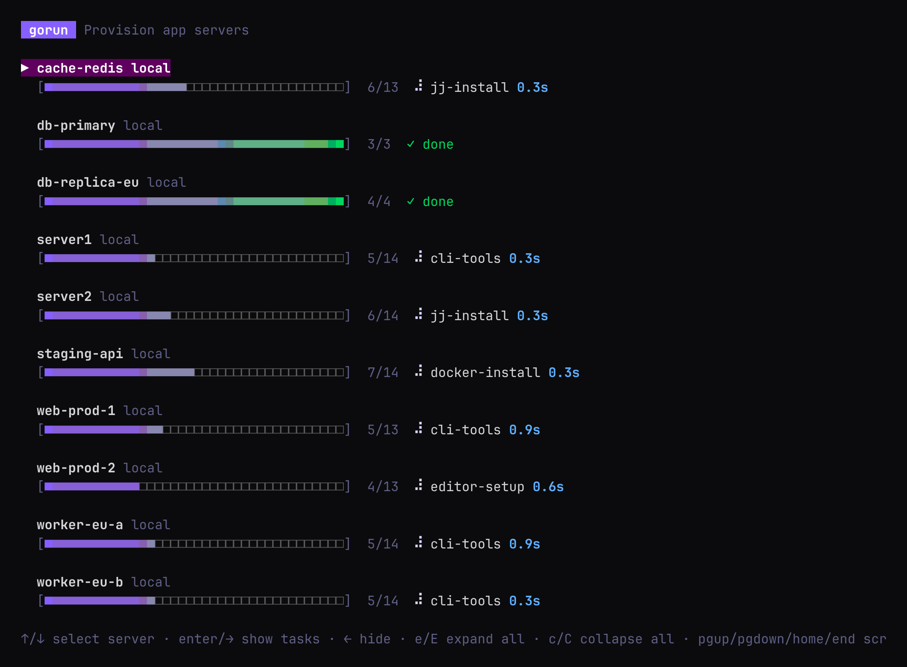

# Gorun

[](https://pkg.go.dev/github.com/jenmud/gorun)
[](https://hub.xerj.org/contributors/jenmud)

**Run plain shell commands on a pile of servers, in parallel, and watch it happen.**

One Go binary, one TOML file and SSH. Nothing to install on the servers.



- **[Install](#install)**
- **[Quick start](#quick-start)**: running in two minutes
- **[Tutorial](docs/tutorial.md)**: from one task to a full server deployment, step by step
- **[Documentation](#documentation)**
- **[Website](https://go-run.dev)**: an overview, the docs and a playground to try a Gorunfile in your browser

> [!WARNING]
> **Use at your own risk.** gorun runs commands on your servers, often as root. It comes with no
> warranty of any kind (see the [MIT license](LICENSE)). Read your Gorunfiles and try them on
> non-production servers first.

## What it does

You write tasks as shell commands in a **Gorunfile**, and say which servers run which tasks:

```toml
[tasks.update]
cmd = "apt-get update && apt-get upgrade -y"
sudo = true

[tasks.nginx]
check = "dpkg -s nginx"                       # exit 0: already installed, so skip it
cmd = "apt-get install -y nginx"
verify = "systemctl is-active nginx"          # non-zero: the install didn't take, so fail
sudo = true

[servers]
tasks = ["update", "nginx"]

[servers.hosts.web-1]
hostname = "web-1.example.com"
    [servers.hosts.web-1.ssh]
    username = "ubuntu"
```

Then `gorun Gorunfile` lets you pick the servers, runs the tasks on all of them at once, and shows
each server's progress live. Run it again and `nginx` shows as *unchanged* on every server that
already has it; `gorun Gorunfile --check` tells you which servers would change, without touching
any of them.

- **Plain commands.** A task is a shell command or script. When something breaks, you can copy
  the command and run it by hand.
- **Parallel.** Every server runs at the same time. A failure stops that server, not the others.
- **Only what's needed, and proven.** A task's `check` runs first: exit 0 means there is
  nothing to do, so the task is marked *unchanged* and skipped. `check_copies` does the same for
  files, comparing MD5s with the server's copies (the server hashes its own, so a rerun of a
  multi-GB upload sends nothing). A `verify` runs after the command and fails the task if the
  change didn't take. `--check` is a dry run that only runs the checks; `--force` runs everything
  anyway. A task without a check always runs, as before. See
  [checks](docs/gorunfile.md#checks-run-only-when-needed).
- **Nothing runs by accident.** You pick servers and tasks in a picker first, and every task has a
  timeout.
- **Grows with you.** Dependencies, bundles, server groups, tags, templates with per-task
  variables, file copies, retries and secrets from your environment, when you need them. Large
  fleets can be split across files with `include`.
- **Write a task once.** Keep tasks in a git repository and include them in any Gorunfile, pinned to
  a tag or commit and locked in `Gorunfile.lock`:
  `include = ["git::https://github.com/you/tasks.git//web/*.toml?ref=v1.2.0"]`. See the
  [task library recipe](recipes/06-task-library/README.md).
- **Big uploads.** Copy a file or a whole directory to every server and watch each upload's
  percentage, size and speed in the terminal and the web UI. See
  [upload progress](docs/gorunfile.md#upload-progress) and the
  [big upload recipe](recipes/07-big-upload/README.md).
- **Remembers.** Every run is saved, with its commands and output, to look back on later.
- **Exports.** Dump every task as a standalone, runnable shell file with `--dump-tasks`, to audit
  or run by hand.
- **Task browser.** The picker’s **Tasks** tab previews each task’s description, details, command,
  execution settings, env vars, and vars beside the dependency tree, with collapsible sections and
  direct editing of file-backed commands.
- **History.** Past runs are saved with commands and output; expanded servers list tasks slowest
  first.
- **Schedules.** A `[[schedule]]` runs a task or bundle on a cron pattern or once at a set time,
  in any time zone. `gorun -web` fires them and keeps a history of every run, skipped run and
  failed run. Pause, resume or skip them from the web UI.
- **Web UI.** `gorun -web` shows the tasks, bundles, schedules and history, and lets you add and
  edit them, with names linked to where they're defined. It starts its own NATS server when none
  is running.

**When to use something else:** gorun runs commands. Checks let a task skip itself and `--check`
shows what would change, but the checks are yours to write: there are no modules that know how
to manage a package or a file, no facts, no dynamic inventories and no secrets vault. For that,
use Ansible, Salt, Puppet or Nix.

## Install

```bash
curl -fsSL https://raw.githubusercontent.com/jenmud/gorun/master/scripts/install.sh | sh
```

Or download a binary from the [releases](https://github.com/jenmud/gorun/releases), or build it
yourself with `go build -o gorun ./cmd`.

<details>
<summary>Two builds: instrumented (default) and standard</summary>

The install script installs the **instrumented** build, which adds
[OpenTelemetry](docs/integrations.md#logs-and-opentelemetry) support. It does nothing until you
set an `OTEL_*` endpoint. For the **standard** build without it:

```bash
curl -fsSL https://raw.githubusercontent.com/jenmud/gorun/master/scripts/install.sh | INSTALL_VARIANTS=1 sh
```

Prebuilt binaries are for Linux x86-64; elsewhere the script builds from source.

</details>

## Quick start

```bash
gorun -dump > Gorunfile      # write a starting Gorunfile; it runs as-is on this machine
gorun Gorunfile              # pick what to run: space selects, enter runs
gorun Gorunfile --run        # or run everything, without the picker
gorun Gorunfile --run --check  # dry run: which tasks would run, changing nothing
```

The starting file runs on your own machine, and documents every option in comments. Its tasks are
marked `local = true`: a server without SSH settings runs only those, and every other task runs
only over SSH. To run on a real server, add one with an `ssh` table, and remove `local = true`
from the tasks it should run:

```toml
[servers.hosts.web-01]
hostname = "web-01.example.com"
    [servers.hosts.web-01.ssh]
    username = "deploy"
    identityfile = "~/.ssh/id_ed25519"
```

Then check what it will run with `gorun Gorunfile --list-servers`.

```bash
gorun Gorunfile --dump-tasks ./tasks   # write each task as a runnable shell file
```

**Next:** the [tutorial](docs/tutorial.md) builds up a real deployment one step at a time.

## Use it from Go

Everything gorun does is in the `gorun` package, so your own tools can run Gorunfiles and follow
every step through progress events:

```bash
go get github.com/jenmud/gorun@latest
```

```go
var cfg gorun.Config
if err := cfg.LoadFile("Gorunfile"); err != nil {
	log.Fatal(err)
}
cfg.OnEvent = func(event any) { // called from one goroutine per server
	if ev, ok := event.(gorun.TaskEvent); ok && ev.State != gorun.TaskRunning {
		fmt.Printf("%s: %s %s, exit %d\n", ev.Server, ev.Task, ev.State, ev.ExitCode) // done, unchanged, failed…
	}
}
err := cfg.Run(context.Background())
```

Set `cfg.CheckOnly` for a dry run, or `cfg.Force` to skip the checks. A task's event carries its
check's and verify's results in `ev.Check` and `ev.Verify`.

To save runs, set `Config.Recorder`. The `history` package's store is a recorder that writes to
the same database as the CLI and web UI, so your program's runs show up there too, and it reads
them back:

```go
h, _ := history.Open(history.DefaultPath())
cfg.Recorder = h       // saves every event; OnEvent stays free for your own handler
runs, _ := h.Runs(ctx) // newest first; also Run, Task, Delete and Keep
```

Any type with a `Record(event any)` method is a `gorun.Recorder`, so runs can go to your own
database, a log or a queue instead.

[`examples/`](examples/README.md) has two complete apps built this way: **servicedeck**, a web app
that manages services across a fleet with live progress in the browser, and **rollout**, a CLI
that draws its own progress bars. The events and the rest of the API are in
[Integrations](docs/integrations.md#using-gorun-as-a-go-library) and on
[pkg.go.dev](https://pkg.go.dev/github.com/jenmud/gorun).

## Documentation

| Read | To |
|---|---|
| [Website](https://go-run.dev) | an overview of gorun, with the docs and a playground to try a Gorunfile in your browser |
| [Tutorial](docs/tutorial.md) | learn gorun step by step, from hello world to a full deployment |
| [The Gorunfile](docs/gorunfile.md) | understand every option: tasks, copies, secrets, servers, bundles, groups |
| [Schedules](docs/schedules.md) | run a task or bundle on a cron pattern or at a set time, in any time zone |
| [Running gorun](docs/running.md) | use the picker, the live view, filters, CI mode and the history |
| [The web UI](docs/web.md) | use `gorun -web`: run, browse, add and edit tasks, bundles and schedules, and read the history |
| [Recording runs](docs/history.md) | keep runs with the built-in SQLite recorder or your own, and what each event carries |
| [Integrations](docs/integrations.md) | use the web UI, OpenTelemetry, NATS events, the Go library and shell completion |
| [Reference](docs/reference.md) | look up any flag, Gorunfile key, environment variable or shortcut |
| [Recipes](recipes/README.md) | try bigger examples against a lab of a hundred SSH servers |
| [Examples](examples/README.md) | build your own tools on the Go library: a web app and a CLI with live progress |

## Development

```bash
make test                     # run the tests
make build                    # build the standard and instrumented binaries
make up                       # start the example lab: a hundred SSH servers and NATS
gorun recipes/Gorunfile -r    # run the lab starter
make web-dev                  # the web UI with live reload
make examples                 # vet and build the library examples
```

The terminal screenshots are made by [`docs/screenshots/capture.sh`](docs/screenshots/capture.sh);
run it again after changing the UI. The web dashboard screenshots are taken by hand.
