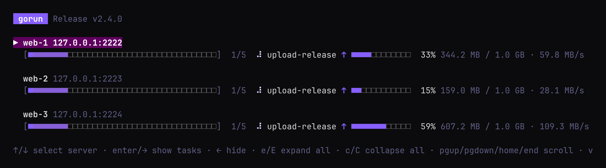
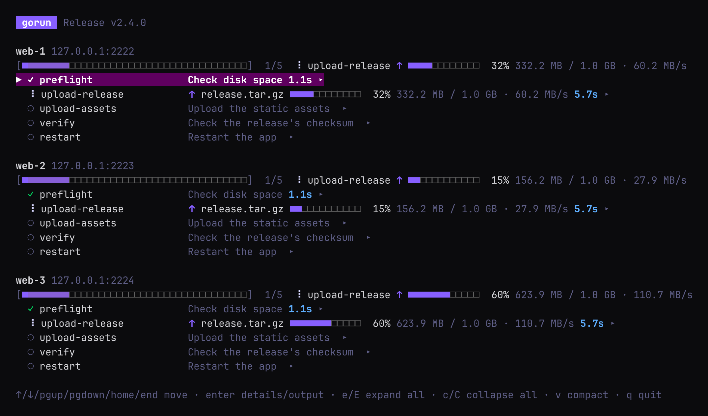
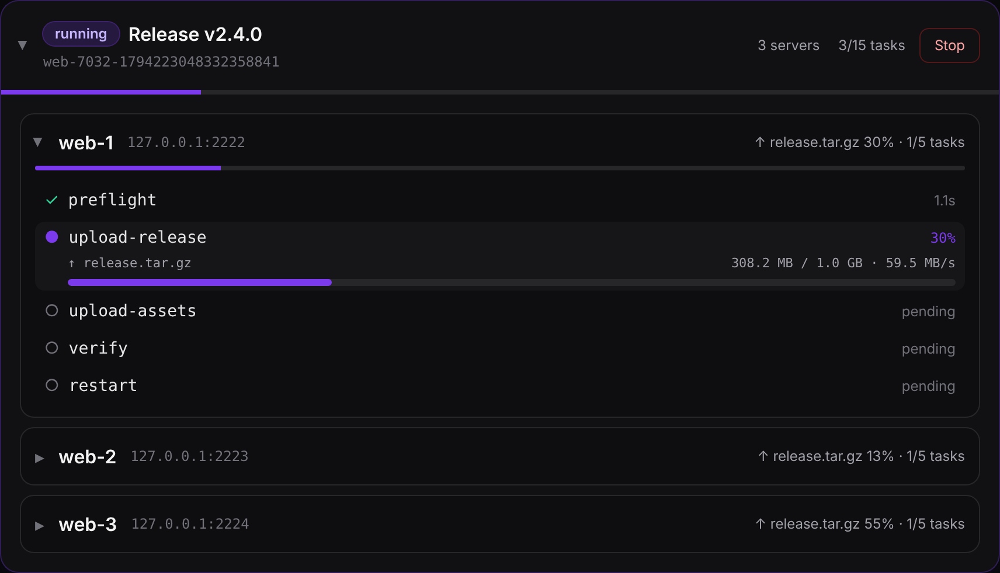

# The Gorunfile

A Gorunfile is a TOML file that says **what to run** (tasks) and **where to run it** (servers).
New to gorun? Start with the [tutorial](tutorial.md). This page explains every option; the
[reference](reference.md#gorunfile-keys) lists them all in one table.

**Contents**

- [The shape of a Gorunfile](#the-shape-of-a-gorunfile)
- [Tasks](#tasks)
  - [Commands](#commands) · [Templates](#templates) · [Task variables](#task-variables) · [Copying files](#copying-files) · [Dependencies](#dependencies)
  - [Environment variables and secrets](#environment-variables-and-secrets) · [Timeouts](#timeouts) · [Retries](#retries) · [Descriptions and rerun safety](#descriptions-and-rerun-safety) · [Local-only tasks](#local-only-tasks)
- [Servers](#servers)
  - [SSH or local](#ssh-or-local) · [Choosing a server's tasks](#choosing-a-servers-tasks) · [Server variables](#server-variables)
- [Bundles](#bundles)
- [Server groups and tags](#server-groups-and-tags)
- [Splitting a large Gorunfile](#splitting-a-large-gorunfile)
- [How settings combine](#how-settings-combine)
- [Parallelism](#parallelism)
- [Paths and mistakes](#paths-and-mistakes)
- [Appendix: keys by section](#appendix-keys-by-section)

## The shape of a Gorunfile

```toml
title = "Provision app servers"      # shown in the picker, the live view and the history

[tasks.timezone]                      # TASKS: what can run, each defined once
cmd = "timedatectl set-timezone UTC"
sudo = true

[bundles.baseline]                    # BUNDLES: a name for a list of tasks (optional)
tasks = ["timezone"]

[server_groups.prod]                  # SERVER GROUPS: settings shared by servers (optional)
tags = ["prod"]
    [server_groups.prod.ssh]
    username = "deploy"
    identityfile = "~/.ssh/id_ed25519"

[servers]                             # SERVERS: what every server runs...
tasks = ["@baseline"]

[servers.hosts.web-01]                # ...and the servers themselves
hostname = "web-01.example.com"
groups = ["prod"]
```

The config calls each server a *host* (`[servers.hosts.<name>]`); the flags and these docs say
*server*. They mean the same thing.

`gorun -dump` prints a starting Gorunfile that runs as-is and documents every option in comments.
[`recipes/Gorunfile`](../recipes/Gorunfile) and the [tutorial's file](tutorial/Gorunfile) are
complete examples.

## Tasks

### Commands

A task has **one** command source:

| Key | Runs |
|---|---|
| `cmd` | a shell command |
| `cmd_file` | a local script, sent to the server |
| `cmd_template` | a [template](#templates), rendered for each server |
| `cmd_template_file` | the same, from a local file |

```toml
[tasks.packages]
cmd_file = "./scripts/packages.sh"
sudo = true
```

- **`sudo = true`** runs the command with `sudo -n`, so the login user needs passwordless sudo.
- **`shell`** sets the shell for local servers (default `sh -c`). Over SSH the command runs in the
  remote login shell, or `sh -c` with sudo.
- A task can also have only [copies](#copying-files) and no command.

### Templates

Templates are [Go templates](https://pkg.go.dev/text/template) that see the server they run on:

| Template | Gives |
|---|---|
| `{{.Name}}` | the server's name (`web-01`) |
| `{{.Hostname}}` | its address (`web-01.example.com`) |
| `{{.SSH.Port}}` | its SSH port |
| `{{.Tags}}` | its tags, e.g. `{{range .Tags}}{{.}} {{end}}` |
| `{{index .EnvVars "REGION"}}` | one of its [env vars](#environment-variables-and-secrets), including its groups' |
| `{{.Vars}}` / `{{.vars}}` | the task's own [variables](#task-variables), e.g. `{{.vars.port}}` |

```toml
[tasks.greet]
cmd_template = "echo 'hello from {{.Name}} on {{.Hostname}}'"
```

### Task variables

A task can carry its own data in `[tasks.<name>.vars]` (or inline as `vars = { ... }`), which its
templates read as `{{.vars}}` or `{{.Vars}}`. A value can be a string, a number, a boolean, a
nested table or a list of tables, so a template can loop over a structure:

```toml
[tasks.caddyfile]
cmd = "cp /tmp/myapp.Caddyfile /opt/myapp/Caddyfile"
sudo = true
[[tasks.caddyfile.copy]]
src_template = "./templates/Caddyfile.tmpl"
dst = "/tmp/myapp.Caddyfile"

[tasks.caddyfile.vars]
port = 8080

[[tasks.caddyfile.vars.redirects]]
from = "/docs"
to = "https://docs.example.com"
```

`templates/Caddyfile.tmpl`:

```
{{.Hostname}} {
	reverse_proxy app:{{.vars.port}}
{{- range .vars.redirects}}
	redir {{.from}} {{.to}}
{{- end}}
}
```

Inside a `range`, `.` is the item being looped over and `$` is still the whole template data, so
`{{$.vars.port}}` reaches the port from inside the loop.

`vars` belong to the task, so they are the same wherever it runs, and they reach that task's
templates only — `cmd_template`, `cmd_template_file` and a copy's `src_template` — never the
command's environment. For a value the command needs, a secret, or anything that differs per
server or group, use [envvars](#environment-variables-and-secrets) and read it in a template with
`{{index .EnvVars "NAME"}}`.

**Server vars.** Templates can also read data that belongs to the host rather than the task. Put it
in `vars` on the global config, a server group, a server, or a bundle, and read it as
`{{.Server.Vars.KEY}}`:

```toml
[servers.hosts.web-01]
vars = { port = 8080 }
```

```
{{.Hostname}} listens on {{.Server.Vars.port}}
```

These layers merge the same way [envvars](#environment-variables-and-secrets) do — global, then
each group, then the bundle, then the host, later ones winning — and a task's own `vars`
(`{{.vars}}`) stay separate, so the two never clash. Use server vars for host-specific template
data; use task vars for data that belongs to the task and is the same everywhere it runs.

### Copying files

Add one or more `copy` tables to a task. Copies run **before** the command.

```toml
[tasks.nginx-config]
cmd = "mv /tmp/site.conf /etc/nginx/conf.d/site.conf && nginx -s reload"
sudo = true
[[tasks.nginx-config.copy]]
src_template = "./templates/site.conf.tmpl"   # rendered for each server
dst = "/tmp/site.conf"
```

| Source | Copies |
|---|---|
| `src` | a local file, or a directory (recursively, like `scp -r`) |
| `src_template` | a template file, rendered for each server |
| `content` | inline text |

| Target | Means |
|---|---|
| `dst` | the target path |
| `dir` | a target directory, keeping the file's name (with `src` only) |

Good to know:

- **Copies don't use sudo.** They run as the login user, so copy to somewhere writable like
  `/tmp` and move the file into place in the command.
- Files are written with mode `0644` and overwrite what's there. Directory copies keep local
  permissions.
- A directory copy creates the target and its parents, leaves other files alone and follows
  symlinks. For a single file, the parent directory must already exist.
- Files from `src` are streamed, so a multi-gigabyte release is fine. `src_template` and
  `content` are built in memory, which suits configs and scripts.
- Stopping a run (Ctrl-C, **Stop** in the web UI, or a task's `timeout`) stops a copy part way.

#### Upload progress

A `src` copy, of a file or a whole directory, shows how far it has got while it runs: the
percentage, the bytes sent and the upload rate. A directory counts every file in it.

```toml
[tasks.upload-release]
description = "Upload the release"
[[tasks.upload-release.copy]]
src = "build/release.tar.gz"      # 1 GB
dst = "/srv/app/releases/v2.4.0/release.tar.gz"
```

The terminal shows a bar on the server's line, and on the task's row in the verbose view:





`gorun -web` shows a bar under the running task, and the upload on a closed server's line:



With `--plain` (CI logs), gorun prints a line as a large copy starts, about every 10%, and when it
is done:

```
web-1: upload-release sending release.tar.gz (1.0 GB)
web-1: upload-release sending release.tar.gz 10% (104.2 MB / 1.0 GB · 59.8 MB/s)
...
web-1: upload-release sent release.tar.gz (1.0 GB in 17.1s, 59.9 MB/s)
```

The progress is what has been sent over the SSH connection. SSH only lets a few megabytes be in
flight before the server reads them, so on a slow link the bar moves at the speed the server is
receiving. A copy is done only once the server has confirmed every byte. Copies of `content` and
`src_template` are small and show no progress.

Programs using the library get the same progress as a
[`CopyProgressEvent`](history.md#copyprogressevent-copy_progress).

### Dependencies

```toml
[tasks.timezone]
cmd = "timedatectl set-timezone UTC"
depends_on = ["packages"]
```

A task's `depends_on` tasks always run first, once, **even if the server doesn't list them**.
Cycles are reported before anything runs. A `depends_on` that names a task no file defines is an
error when the Gorunfile loads, even if nothing runs that task, and the message says which file
(or which git include) the task came from.

### Environment variables and secrets

`envvars` are exported to the task's command, on local and SSH servers alike, also under sudo.
They can be set globally, on a [group](#server-groups-and-tags), on a server, or on a task. The
more specific one wins: task, then server, then its groups, then global. Keys are upper-cased.

```toml
envvars = { APP_ENV = "production" }   # every task

[tasks.deploy]
cmd = 'echo "deploying to $APP_ENV"'
envvars = { LOG_FORMAT = "json" }       # just this task
```

**Secrets:** values expand `$VAR` and `${VAR}` from gorun's own environment, including a `.env`
file in the directory you run gorun from. So the secret stays out of the Gorunfile:

```toml
[tasks.registry-login]
cmd = 'printf %s "$TOKEN" | docker login -u me --password-stdin'
envvars = { TOKEN = "${REGISTRY_TOKEN}" }
```

- Use `$$` for a literal `$`. An unset variable becomes an empty string.
- Values are sent to the task over stdin, so they don't appear in gorun's logs, the history, NATS
  events or the server's process list.

### Timeouts

Every task has a timeout of **30 minutes** unless it sets `timeout` (`90s`, `10m`, `2h`, ...):

```toml
[tasks.migrate]
cmd = "docker compose run --rm migrate"
timeout = "45m"
```

- It covers the task's copies and its command.
- A timed-out task fails with exit code **124** (like `timeout(1)`), and the rest of that
  server's tasks are skipped.
- Local tasks are killed with their whole process group. SSH tasks get `SIGTERM` and the
  connection is closed.
- There is no "run forever"; give a long task a long timeout.

### Retries

Retries are **off** unless a task sets `retries`, the number of extra attempts:

```toml
[tasks.packages]
cmd_file = "./scripts/packages.sh"
retries = 2          # up to three attempts
retry_delay = "1s"   # default 50ms; "0s" retries straight away
```

- Each attempt gets a fresh timeout and empty output.
- A task that succeeds on a retry isn't a failure.
- Timeouts and cancelled runs are never retried.
- `rerun = "unsafe"` tasks aren't retried, unless they also set `retry_unsafe = true`.

### Descriptions and rerun safety

```toml
[tasks.migrate]
cmd = "docker compose run --rm migrate"
description = "Apply database migrations"      # one line: lists, the picker and the live view
details = "Runs every pending migration."        # shown when the task is expanded
rerun = "safe"
```

`rerun` says whether running the task again is harmless:

| Value | Means |
|---|---|
| `safe` | it only converges, like installing a package |
| `unsafe` | it may change the server again or fail, like appending a line. Shown with ⚠, and not [retried](#retries) |
| unset | unknown |

It's a label, not a guard: gorun still runs unsafe tasks when you ask.

### Local-only tasks

> [!WARNING]
> **Upgrading to v0.10.0:** tasks without `local = true` no longer run on local servers. Before,
> a server without SSH settings ran every task it was given; now it runs only tasks marked
> `local = true`. If a local server's list in `gorun Gorunfile --list-servers` is empty, add
> `local = true` to the tasks it should run.

A task runs on one kind of server only:

| Task | Runs on | Left out on |
|---|---|---|
| `local = true` | [local servers](#ssh-or-local) (no SSH settings) | SSH servers |
| without `local` | SSH servers | local servers |

A task that depends on a left-out task is left out too. This applies to every way of running
tasks, including a bundle checked in the picker, so checking a bundle of remote checks doesn't run
them on your own machine.

## Servers

```toml
[servers]
tasks = ["@baseline"]              # what every server runs, unless it says otherwise

[servers.hosts.web-01]
hostname = "web-01.example.com"    # the server's name is used when unset
tags = ["web"]
```

### SSH or local

> [!IMPORTANT]
> A server runs over SSH **only when it has SSH settings**, in its own `ssh` table or from a
> [group](#server-groups-and-tags). A server without them runs on your own machine, and runs
> **only tasks marked [`local = true`](#local-only-tasks)**; every other task runs only over SSH.

```toml
[servers.hosts.db-01]
hostname = "db-01.internal"
    [servers.hosts.db-01.ssh]
    username = "root"
    port = 22
    identityfile = "~/.ssh/id_ed25519"   # or password = "...", but prefer keys
```

- Anything missing (`username`, `port`, `identityfile`, and the real hostname of an alias) is
  read from your SSH config: `config_file` if set, otherwise `~/.ssh/config`.
- Without an `identityfile`, gorun offers every `IdentityFile` your SSH config lists for the host, in
  order, like `ssh` does. Keys that are missing or need a passphrase are skipped. An `identityfile`
  in the Gorunfile is the only key offered.
- Share logins through a [server group](#server-groups-and-tags).
- The global `[ssh]` table only uses `config_file`, and setting it gives **every** server SSH
  settings, so servers that would have run locally then use SSH too, and skip their
  `local = true` tasks.
- gorun opens one SSH connection per server and reuses it for every task.
- Host keys aren't verified, so use gorun on networks you trust.

### Choosing a server's tasks

| On a server | Does |
|---|---|
| nothing | runs `[servers] tasks`, plus its groups' `tasks` |
| `add_tasks = [...]` | runs these as well |
| `skip_tasks = [...]` | leaves these out |
| `tasks = [...]` | replaces the list completely |

`gorun Gorunfile --list-servers` shows every server's final list. The exact rules are under
[how settings combine](#how-settings-combine).

### Server variables

A server, its group, the bundle it pulls tasks from, or the whole Gorunfile can carry template
data that belongs to the host rather than to a task. Put it in `vars` and read it in any template
as `{{.Server.Vars.KEY}}`:

```toml
vars = { region = "eu-west-1" }          # global: every server

[server_groups.app]
vars = { port = 8080 }                  # group: its members

[bundles.base]
vars = { tier = "web" }                  # bundle: servers that pull it in

[servers.hosts.web-01]
vars = { port = 9090, redirects = ["docs"] }   # host: wins over the group
```

```toml
[tasks.show]
cmd_template = "echo {{.Hostname}} {{.Server.Vars.region}} {{.Server.Vars.port}}"
```

The layers merge the same way [envvars](#environment-variables-and-secrets) do — global, then each
group in order, then the bundle, then the host, later ones winning — so a host overrides its
group. A value can be a string, a number, a boolean, a nested table or a list of tables, and it
can be nested the same way task vars can:

```toml
[servers.hosts.web-01.vars]
port = 9090

[[servers.hosts.web-01.vars.redirects]]
from = "/docs"
to = "https://docs.example.com"
```

```
{{range .Server.Vars.redirects}}
redir {{.from}} {{.to}}
{{end}}
```

Server vars are read-only template data: they reach `cmd_template`, `cmd_template_file` and a copy's
`src_template`, never the command's environment, and they never override a task's own `vars`
(`{{.vars}}`), which is a separate namespace. Use them for host-specific template data; use
[task vars](#task-variables) for data that belongs to the task and is the same everywhere it
runs, and [envvars](#environment-variables-and-secrets) for anything the command itself needs or
that is a secret.

## Bundles

A bundle is a name for a list of tasks. Use it as `@name` anywhere a task list goes: `[servers]
tasks`, a server's `tasks`, `add_tasks` and `skip_tasks`, a group's `tasks`, another bundle, and
`--task @name`.

```toml
[bundles.baseline]
description = "Minimal setup every box gets"   # shown by --list-bundles
tasks = ["timezone", "monitoring-tools"]

[bundles.standard]
tasks = ["greet", "@baseline", "verify"]      # bundles can include bundles
```

A bundle expands to its tasks in order, repeats are dropped, and `depends_on` still applies.

Use `--bundles name` (repeatable, globs allowed) to replace each selected server's configured
pipeline with one or more bundles. Unlike `--task @name`, this does not add the bundle to each
server's existing task list; `--bundles` and `--task` cannot be combined.

In the picker, check a bundle on the **Bundles** tab with **space**, then go back to **Servers** and
select the hosts to run it against. While a bundle is checked, each server's tasks pane lists only
that bundle's tasks (and their dependencies).

## Server groups and tags

A **server group** holds settings that servers share by joining it: `tags`, `tasks`, `envvars`,
`log_level` and an `ssh` table.

**Tags** label servers so you can pick them (`--tag web`, or in the picker). A server's tags are
its own plus its groups'.

```toml
[server_groups.lab]                # every machine in the lab shares one login
tags = ["lab"]
    [server_groups.lab.ssh]
    username = "testuser"
    identityfile = "./ssh-keys/id_ecdsa"

[server_groups.eu]
tags = ["eu"]
tasks = ["server-info"]            # added to what eu servers run
envvars = { REGION = "eu-west-1" }

[servers.hosts.worker-eu-b]
hostname = "10.0.4.12"
groups = ["lab", "eu"]
envvars = { REGION = "eu-central-1" }   # the server wins over its groups
    [servers.hosts.worker-eu-b.ssh]
    port = 2229                         # the rest comes from the lab group
```

## Splitting a large Gorunfile

Move tasks, groups and hosts into their own files with a top-level `include` list. Paths and
globs are relative to the file that names them:

```toml
include = [
  "tasks/*.toml",            # shared tasks and bundles
  "groups/*.toml",           # server groups
  "hosts/*/*.toml",          # one folder per role, one file per fleet
]
```

- Every file is merged into one config, so you can use names from any of them.
- A name defined in two files is an error, and the message names both files. File order never
  changes a value.
- Only the root Gorunfile sets `title`, `log_level`, `max_parallel`, `max_task_parallel`, `ssh`
  and `[servers] tasks`.
- A pattern that matches no files is an error. `*` matches within one folder; `**` is not
  supported.
- A file can be included more than once and is read once. Includes that loop back are an error.
- Included files can include other files.
- Servers are listed in read order: the root file first, then each include in sorted order.
- Relative paths in any file (`cmd_file`, copy sources, `identityfile`) are relative to the root
  Gorunfile.

Check the result with `gorun Gorunfile --list-servers`, or `--list-tasks` for the task library.

## Tasks from a git repository

Write a task once, keep it in a git repository, and use it from any Gorunfile. Include it with a
`git::` source, the syntax Terraform and Packer use for modules:

```toml
include = [
  "git::https://github.com/you/task-library.git//web/*.toml?ref=v1.2.0",
  "git::git@bitbucket.org:you/task-library.git//db/*.toml?ref=v1.2.0",   # over SSH
]

[servers]
tasks = ["@web-baseline"]                 # a bundle from the library
```

- **`git::<repository>//<files>?ref=<version>`.** The repository is an `https://` or `ssh://`
  URL, or `git@host:org/repo.git`. After `//` comes a path or glob inside it; without one, gorun
  reads `*.toml` at the top of the repository. `git://` isn't accepted: it is unauthenticated and
  unencrypted.
- **`?ref=` is required**: a tag, a branch or a commit hash. The Gorunfile always says which
  version of the tasks it wants.
- **`Gorunfile.lock`** records the commit each include resolved to. It is written the first time
  an include is used, next to the Gorunfile; commit it. From then on every run uses the locked
  commit, so a moved tag or a new commit on a branch changes nothing until you run
  `gorun Gorunfile --update-includes`, which looks every ref up again, rewrites the lock file and
  prints the commits.
- **Credentials** are git's own: your SSH keys, credential helper and `~/.gitconfig` are used, and
  nothing goes in the Gorunfile. gorun never prompts; a repository that needs credentials you
  haven't set up fails with git's message.
- **Cached and offline.** Each commit is fetched once into gorun's cache (`~/.cache/gorun`, or
  `GORUN_CACHE_DIR`). With the lock file and a filled cache, gorun needs no network.
- **Only tasks and bundles.** A file from a git repository can't add servers, groups, schedules or
  global `envvars` and `vars`, so a shared library never changes where, when or with what your
  commands run. It may include other files from the same repository, or other git repositories.
- **Paths are the library's.** A library task's `cmd_file`, `cmd_template_file` and copy sources
  are relative to the root of its repository.
- Names follow the usual rule: a name defined both in the library and in your files is an error.
- **Keep a library self-contained.** Its tasks' `depends_on` should name tasks in the library.
  Names are shared across every file, so a library task can depend on a task your Gorunfile
  defines, and gorun reports a missing one when the file loads. But then every Gorunfile that uses
  the library has to define a task with exactly that name, and nothing says so. Put your own steps
  around the library's in your Gorunfile instead:

  ```toml
  [servers]
  tasks = ["prepare", "@lib-deploy"]   # your step, then the library's, in that order
  ```
- **Every run records what it used.** The run's history lists each git include with the ref asked
  for and the commit it ran, under **Task libraries** on its page in `gorun -web`, so an old run can
  always be traced to the exact commands.

A task library is an ordinary repository of TOML files, for example:

```
task-library/
  web/base.toml        # [tasks.timezone], [tasks.packages], [bundles.web-baseline]
  web/nginx.toml
  scripts/nginx.sh     # cmd_file = "scripts/nginx.sh" in web/nginx.toml
```

Programs built on the gorun library get the same: `LoadFile` fetches and caches git includes and
writes the lock file. Set `Config.UpdateIncludes` to look refs up again, and read
`Config.Includes` for the commit each one used.

See [recipes/large-inventory](../recipes/large-inventory) for a complete example that splits tasks,
groups and hosts across multiple files.

## Schedules

A `[[schedule]]` table runs a task or bundle on every server, on a cron pattern or once at a
set time. The scheduler runs inside `gorun -web`. See [schedules](schedules.md) for the
syntax, time zones and missed runs.

```toml
[[schedule]]
name = "nightly-backup"
target = "@backup"
cron = "0 2 * * *"
timezone = "Australia/Sydney"
```

## How settings combine

Settings are layered: global, then each group **in the order the server lists them**, then the
server itself. A later layer wins.

| Setting | Combines like this |
|---|---|
| `log_level`, each `ssh` field | the last one set wins |
| `envvars` | merged by key, the last one wins (a task's own still win) |
| `tags` | all of them, without repeats |

A server's task list is built like this:

1. If the server sets `tasks`, that list is used, and the global and group lists are ignored.
2. Otherwise it's `[servers] tasks`, then each group's `tasks`, in order.
3. `add_tasks` are added and `skip_tasks` removed. Bundles are expanded first, so
   `skip_tasks = ["@baseline"]` skips the whole bundle. Repeats are dropped.

## Parallelism

| Setting | Controls | Default |
|---|---|---|
| `max_parallel` | servers at once | `0`, all of them |
| `max_task_parallel` | tasks at once on each server | `0`, one at a time; `-1` means all independent tasks together |

Both can be set at the top of the file; `max_task_parallel` can also be set per server.
`--parallel N` overrides `max_parallel` for one run.

## Paths and mistakes

- Relative paths (`cmd_file`, copy sources, `identityfile`, ...) are relative to the Gorunfile,
  so you can run gorun from anywhere. `~/` is your home directory.
- **Mistakes are errors, before anything runs:** unknown keys (a typo like `cmd_flie`), unknown
  tasks, groups or bundles, dependency cycles, and skipping a task that another of the server's
  tasks depends on.
- An unknown task in a server's own list is only reported for the servers you're running on, so
  `--server` can still run the others.

## Appendix: keys by section

Every key, grouped by the table it belongs to. `gorun -dump` prints the same list in place.

### Top level

| Key | Description |
|---|---|
| `title` | shown in the picker, the TUI and the history |
| `include` | files or globs to merge in, relative to this file; see [splitting a large Gorunfile](#splitting-a-large-gorunfile) |
| `log_level` | `debug`, `info`, `warn` or `error`; servers and tasks inherit it |
| `max_parallel` | servers at once; `0` (default) means all |
| `max_task_parallel` | tasks at once per host; `0` (default) means one at a time, `-1` means all |
| `envvars` | env vars for every task |
| `vars` | template variables for every task on this run (a task's own vars win) |
| `[ssh]` | only `config_file` (or `config`) is used |

### `[tasks.<name>]`

| Key | Description |
|---|---|
| `cmd`, `cmd_file`, `cmd_template`, `cmd_template_file` | the command (pick one) |
| `copy` (also `copies`, `upload`, `files`) | file copies |
| `depends_on` | tasks that must run first |
| `sudo` | run with `sudo -n` |
| `shell` | shell for local hosts (default `sh -c`) |
| `envvars` | env vars for this task |
| `vars` | template variables for this task (map, may nest) |
| `log_level` | log level for this task |
| `timeout` | Go duration, default `30m` |
| `retries`, `retry_delay`, `retry_unsafe` | retries |
| `description`, `details`, `rerun` | descriptions and rerun safety |
| `local` | run only on local (no-SSH) servers; without it, the task runs only over SSH |

### `[tasks.<name>.copy]` / `[[tasks.<name>.copy]]`

| Key | Description |
|---|---|
| `src` | a file, or a directory copied recursively |
| `src_file` | alias for `src` |
| `src_template` (also `src_tmpl`, `template`) | a template rendered for each server |
| `content` | inline text written to `dst` |
| `dst` (also `dst_path`, `dest`) | destination path on the server |
| `dir` | destination directory (keeps the source file name) |
| `mode` (also `perm`) | file mode, e.g. `0644` |

### `[bundles.<name>]`

| Key | Description |
|---|---|
| `description` | one line, shown in lists |
| `tasks` | task names and `@bundles` |
| `vars` | template variables for the tasks it pulls in |

### `[server_groups.<name>]`

| Key | Description |
|---|---|
| `tags` | tags for selection |
| `tasks` | tasks for members |
| `envvars` | env vars for every task |
| `vars` | template variables (merged into the server) |
| `log_level` | log level |
| `[ssh]` | `username`, `port`, `identityfile`, `password`, `config_file` |

### `[[schedule]]`

`name` (required, unique), `description`, `target` (a task or `@bundle`, required), `cron`
(five fields) or `at` (one time), `timezone` (IANA name, default UTC) and `missed` (`skip`,
the default, or `run`). See [schedules](schedules.md).

### `[servers]`

| Key | Description |
|---|---|
| `tasks` | tasks every host runs |

### `[servers.hosts.<name>]`

| Key | Description |
|---|---|
| `hostname` | address to connect to (the name is used when unset) |
| `groups` | server groups to join, in order |
| `tags` | tags for selection |
| `tasks` | replaces the global and group task lists |
| `add_tasks`, `skip_tasks` | append to / remove from the task list |
| `envvars` | env vars for every task on this host |
| `vars` | template variables for this host (read as `{{.Server.Vars.KEY}}`) |
| `log_level` | log level for this host |
| `[ssh]` | `username`, `port`, `identityfile`, `password`, `config_file` |
