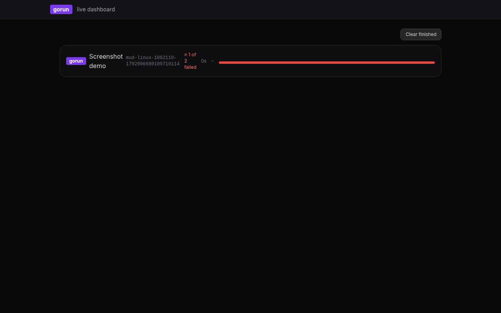
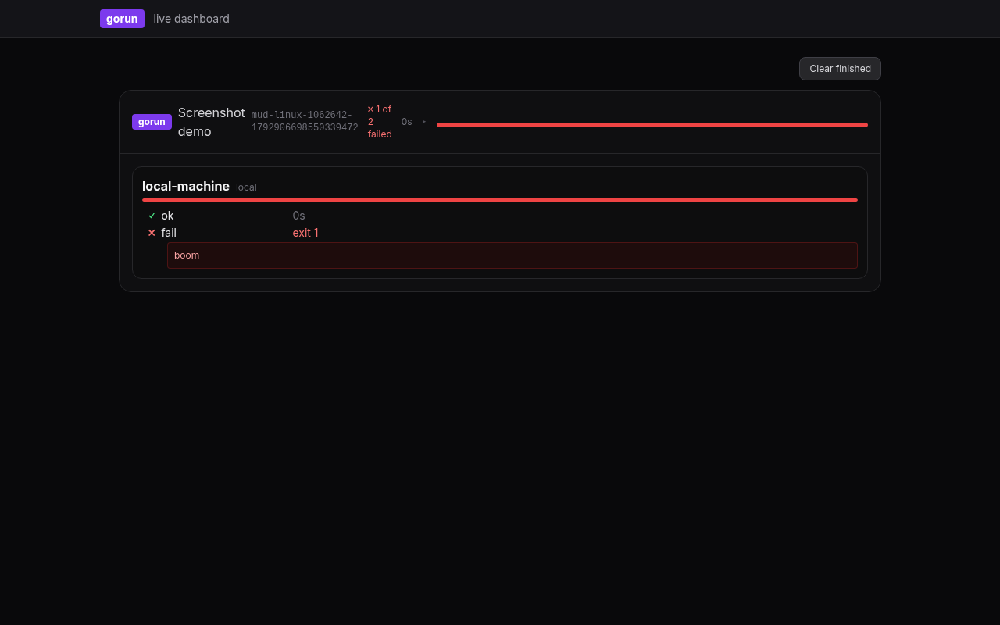

# Integrations

**Contents**

- [Web UI](#web-ui)
- [Logs and OpenTelemetry](#logs-and-opentelemetry)
- [Events (NATS)](#events-nats)
- [Using gorun as a Go library](#using-gorun-as-a-go-library)
- [Shell completion](#shell-completion)

## Web UI

`gorun -web` starts a web server (`GORUN_ADDRESS`, default `:8080`) with a live dashboard of
running gorun processes and the run history. The live dashboard follows runs through
[NATS](#events-nats). It is built with [templ](https://templ.guide), [Datastar](https://data-star.dev)
and Tailwind CSS.



Each gorun process is a card with its title, progress and status, and failed runs show their
failure box. Click a card for the per-server, per-task detail:



Successful runs disappear on their own; **Clear finished** removes failed ones. `/runs` lists the
history from the database, with a page per run, a delete button and "Keep 10 most recent".

## Logs and OpenTelemetry

gorun's own log messages go to `~/.gorun/gorun.log` (or `GORUN_LOG_FILE`), not the terminal. The
file is appended to on every run, and server and task lines carry the run's `gorun_uuid`. When a
plain-mode run fails, the error message includes the path.

The **instrumented build** (the default from the install script) adds OpenTelemetry traces,
metrics and logs, but only exports what you configure. With no OTLP endpoint or exporter set,
everything is off, so a run without a collector never tries to connect anywhere:

```bash
OTEL_EXPORTER_OTLP_ENDPOINT=http://localhost:4318 gorun Gorunfile           # every signal
OTEL_EXPORTER_OTLP_TRACES_ENDPOINT=http://collector:4318/v1/traces gorun Gorunfile   # traces only
OTEL_TRACES_EXPORTER=console gorun Gorunfile -r --plain                     # spans to the log file
```

Each signal is configured on its own. `GORUN_NAME` is the service name unless `OTEL_SERVICE_NAME`
is set. The standard build has no OpenTelemetry.

## Events (NATS)

When a [NATS](https://nats.io) server is reachable, gorun publishes each run's events to it, as
JSON on `gorun.events` (or `GORUN_EVENT_TOPIC`); the web UI's live dashboard uses them. Without
NATS gorun runs as normal. Set `GORUN_SKIP_NATS=1` to not try at all.

```bash
make up    # starts the example lab, including a NATS server (see ../recipes/docker-compose.yml)
```

Every event has a `type` and the run's `gorun_uuid`:

| Type | Sent | Fields |
|---|---|---|
| `process_started` | when a run starts | `title`, `servers`, `started_at`, `hostname`, `pid` |
| `plan` | per server, before it starts | `server`, `address`, `tasks`, `task_meta` |
| `task` | every task state change | `server`, `task`, `state`, `command`, `stdout`, `stderr`, `exit_code`, `duration`, `attempt`, `attempts` |
| `server_error` | a server couldn't run (e.g. SSH failed) | `server` |
| `process_finished` | when the run ends | `success`, `duration`, `total_tasks`, `failed`, `skipped`, `finished_at` |

`command` is the command as written, with templates rendered. Events are published synchronously,
so short runs don't lose any. The connection is configured with the `GORUN_NATS_CLIENT_*`
[variables](reference.md#environment-variables).

## Using gorun as a Go library

The CLI and TUI live under `cmd`; the rest is the `gorun` package. Load a Gorunfile, select
servers and tasks the way the command-line flags do, and get every event as it happens:

```bash
go get github.com/jenmud/gorun
```

```go
f, err := os.Open("recipes/04-dev-server/Gorunfile")
if err != nil {
	log.Fatal(err)
}
defer f.Close()

var cfg gorun.Config
if err := cfg.Load(f); err != nil {
	log.Fatal(err)
}
cfg.ResolvePaths(filepath.Dir(f.Name())) // relative paths are relative to the Gorunfile

// the same as `--tag web --task @baseline`
servers, err := cfg.SelectServers(gorun.ServerFilter{Tags: []string{"web"}})
if err != nil {
	log.Fatal(err)
}
tasks, err := cfg.ExpandTaskPatterns("@baseline")
if err != nil {
	log.Fatal(err)
}
for i := range servers {
	servers[i].TaskNames = tasks
}

cfg.OnEvent = func(event any) {
	if ev, ok := event.(gorun.TaskEvent); ok && ev.State != gorun.TaskRunning {
		fmt.Printf("%s: %s exit %d\n", ev.Server, ev.Task, ev.ExitCode)
	}
}

if err := cfg.Run(context.Background(), servers...); err != nil {
	log.Fatal(err)
}
```

`ServersPipeline` returns every server's resolved task list, and `RunTask` runs a single task
(with its dependencies) on some or all servers. `AllServers` returns every configured server,
`LocalServer` (and the package-level `gorun.LocalServer`) give a server that runs on this
machine, and `RunLocal` runs tasks locally without needing an SSH server. `NewLocalTaskExec`
creates task executors that run locally, and `Server.IsLocal` reports whether a server has no SSH.

A local server runs only tasks marked [`local = true`](gorunfile.md#local-only-tasks), and every
other task runs only over SSH. This holds for `Run`, `RunLocal` and the pipelines
(`ServersPipeline`, `ServerPipeline`): tasks of the wrong kind, and tasks that depend on them, are
dropped. `RunTask` returns an error when none of its servers can run the task.

## Shell completion

Bash can complete gorun's flags, Gorunfile paths, and the task, bundle, server, tag and group
names from a Gorunfile. Add this to `~/.bashrc`:

```bash
_gorun_complete() {
    local cur prev file word i
    cur=${COMP_WORDS[COMP_CWORD]}
    prev=${COMP_WORDS[COMP_CWORD-1]}

    # Find the Gorunfile argument, skipping flags and their values.
    for ((i = 1; i < COMP_CWORD; i++)); do
        word=${COMP_WORDS[i]}
        case $word in
            -task|--task|-bundles|--bundles|-server|--server|-exclude-server|--exclude-server|-tag|--tag|-group|--group|-parallel|--parallel) ((i++)) ;;
            -*) ;;
            *) file=$word; break ;;
        esac
    done

    # Stock bash splits words at "@", so "--task @ba" arrives as "--task" "@" "ba".
    if [[ $prev == @ && ( ${COMP_WORDS[COMP_CWORD-2]} == -task || ${COMP_WORDS[COMP_CWORD-2]} == --task ) ]]; then
        COMPREPLY=($(compgen -W "$(gorun -complete tasks "$file" 2>/dev/null | sed -n 's/^@//p')" -- "$cur"))
        return
    fi
    if [[ $prev == @ && ( ${COMP_WORDS[COMP_CWORD-2]} == -bundles || ${COMP_WORDS[COMP_CWORD-2]} == --bundles ) ]]; then
        COMPREPLY=($(compgen -W "$(gorun -complete bundles "$file" 2>/dev/null)" -- "$cur"))
        return
    fi

    case $prev in
        -task|--task)
            COMPREPLY=($(compgen -W "$(gorun -complete tasks "$file" 2>/dev/null)" -- "$cur"))
            return
            ;;
        -bundles|--bundles)
            COMPREPLY=($(compgen -W "$(gorun -complete bundles "$file" 2>/dev/null)" -- "$cur"))
            return
            ;;
        -server|--server|-exclude-server|--exclude-server)
            COMPREPLY=($(compgen -W "$(gorun -complete servers "$file" 2>/dev/null)" -- "$cur"))
            return
            ;;
        -tag|--tag)
            COMPREPLY=($(compgen -W "$(gorun -complete tags "$file" 2>/dev/null)" -- "$cur"))
            return
            ;;
        -group|--group)
            COMPREPLY=($(compgen -W "$(gorun -complete groups "$file" 2>/dev/null)" -- "$cur"))
            return
            ;;
    esac

    if [[ $cur == -* ]]; then
        COMPREPLY=($(compgen -W "-v -plain -run -r -task -bundles -server -exclude-server -tag -group -parallel -list-tasks -list-servers -list-tags -list-groups -list-bundles -dump -dump-tasks -version -web -history -h --task --bundles --server --exclude-server --tag --group --parallel --run --plain --list-tasks --list-servers --list-tags --list-groups --list-bundles --dump --dump-tasks --version --web --history --help" -- "$cur"))
    else
        COMPREPLY=($(compgen -f -- "$cur"))
    fi
}

complete -o filenames -F _gorun_complete gorun
```

`gorun -complete <kind> [Gorunfile]` prints the names for `tasks` (including `@bundles`),
`bundles`, `servers`, `tags` or `groups`, using `./Gorunfile` when no file is given.
