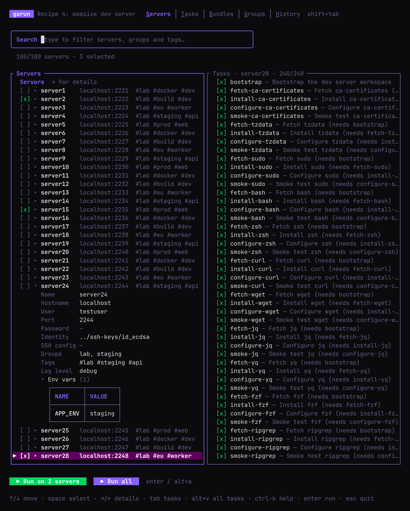
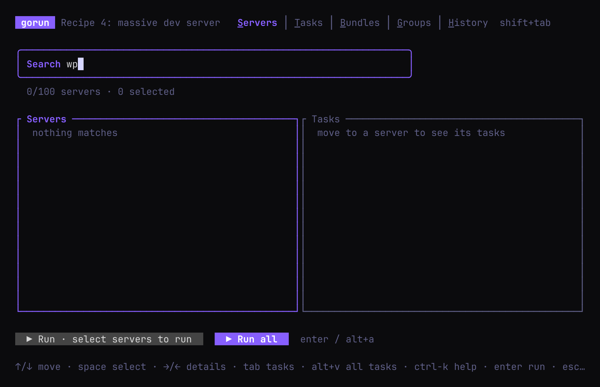
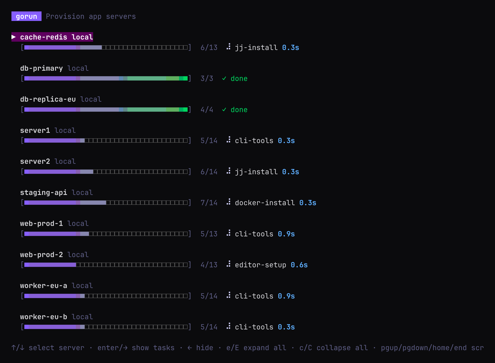
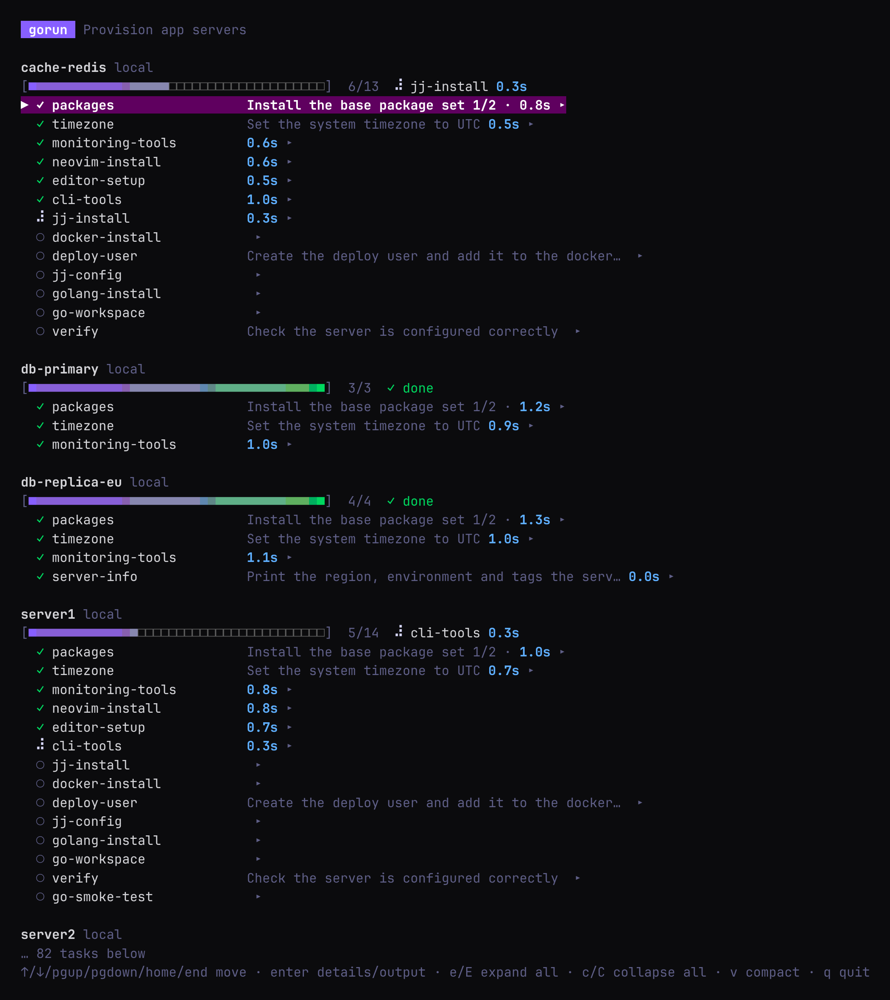
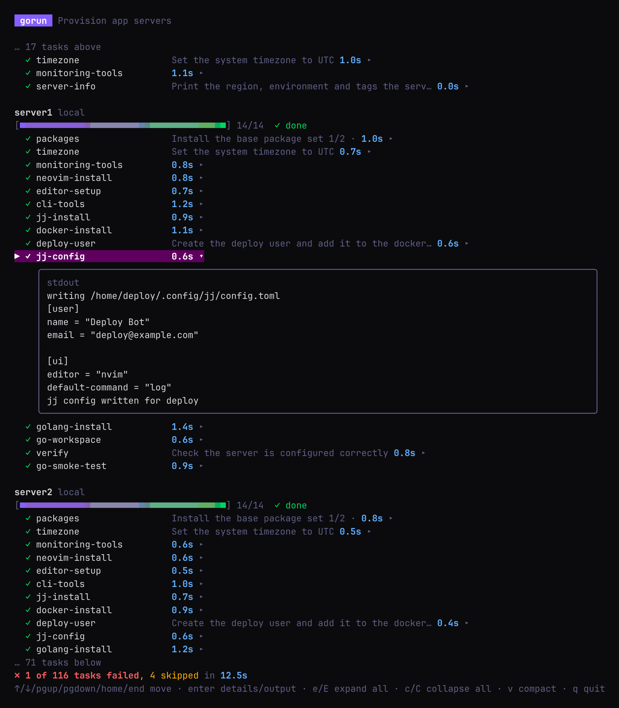
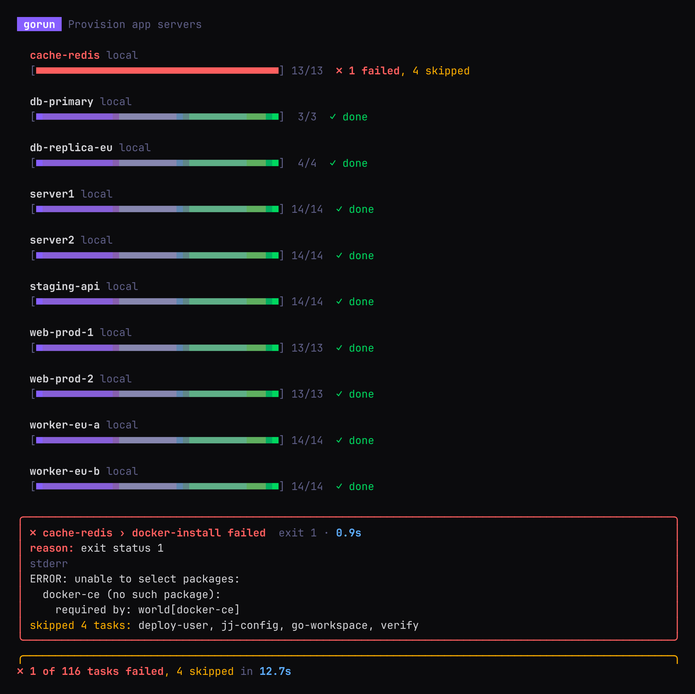
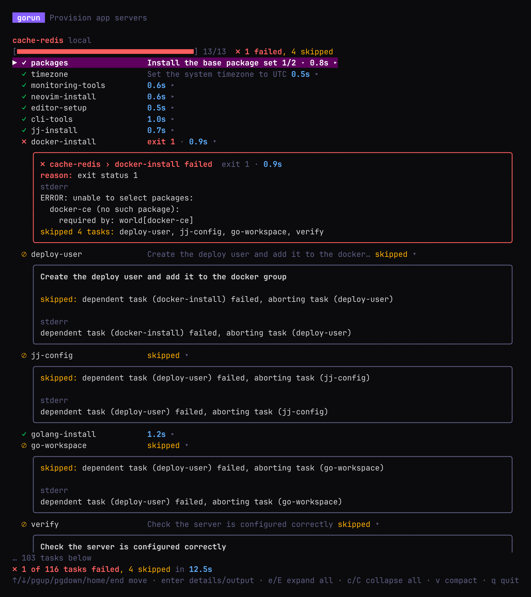
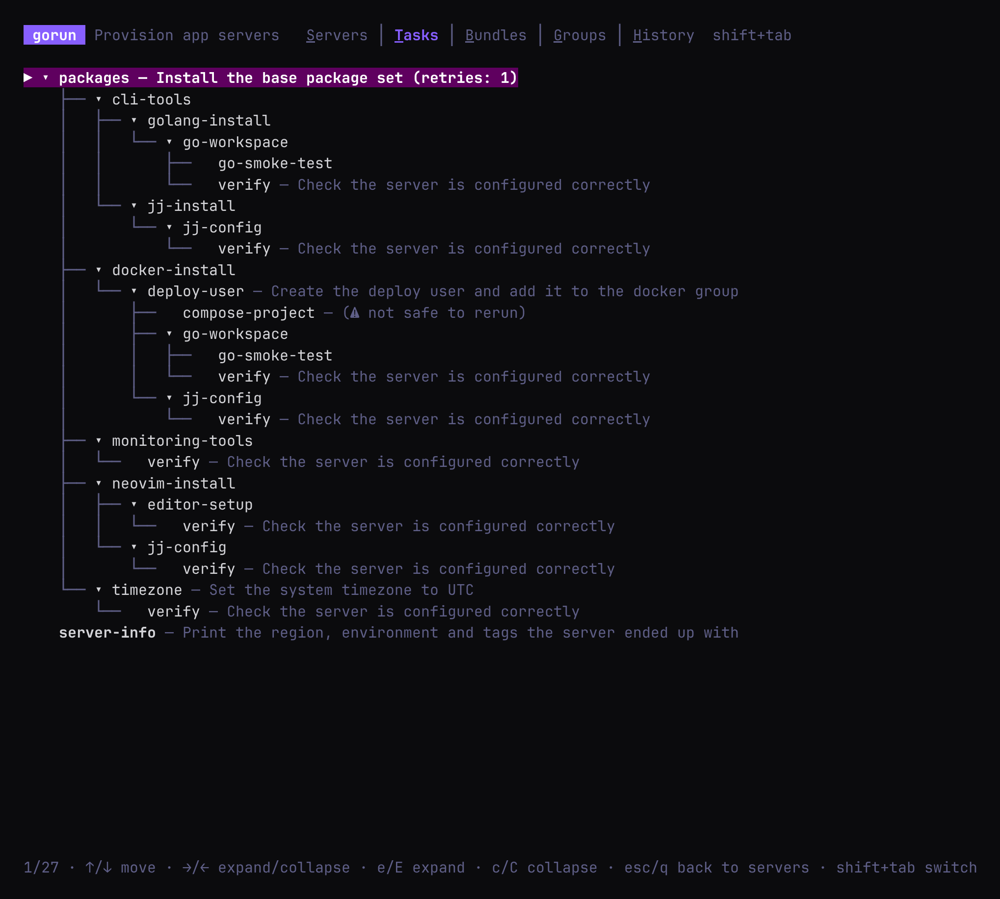
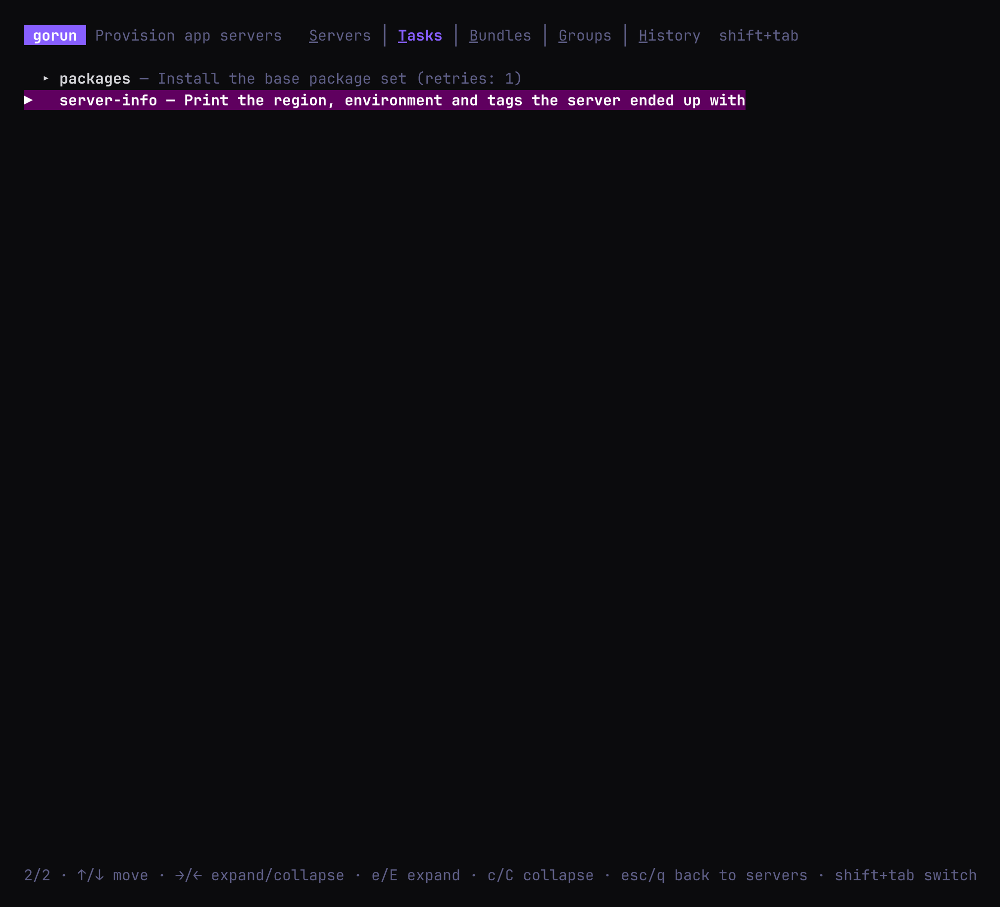

# Running gorun

**Contents**

- [The basics](#the-basics)
- [The picker](#the-picker)
- [Watching a run](#watching-a-run)
- [Running without the picker (scripts and CI)](#running-without-the-picker-scripts-and-ci)
- [Choosing servers and tasks](#choosing-servers-and-tasks)
- [Checking a Gorunfile before you run it](#checking-a-gorunfile-before-you-run-it)
- [History](#history)

## The basics

```bash
gorun Gorunfile                    # pick servers and tasks, then run
gorun Gorunfile -v                 # the same, listing every task while it runs
gorun Gorunfile --run              # run everything, no picker (-r)
gorun Gorunfile -r --plain         # plain text instead of the live view, e.g. for CI
gorun Gorunfile -r --parallel 4    # at most 4 servers at a time
```

## The picker

Unless you pass `--run`, every run starts in the picker. **Nothing runs until you select it.**



1. **Select servers** with **space** (or a click). Selecting a **group** or **tag** selects all of
   its servers.
2. **Type to filter.** The match is fuzzy: `wp` finds `web-prod-1`.
3. **Press → on a server** to see its tasks. Untick a task to leave it out of this run; tasks that
   need it are unticked too.
4. **Press enter** to run.



A checkbox shows `[x]` when all of a group's servers are selected, `[-]` when some are, and `[ ]`
when none are. A server's row shows how many of its tasks are ticked, e.g. `11/15 tasks`.

The other tabs, **Tasks**, **Bundles** and **Groups**, let you browse what's in the Gorunfile.
**History** shows [past runs](#history). Press **shift+tab** to move between tabs, and
**ctrl+k** for a list of every shortcut.

Command-line filters narrow what the picker offers: `gorun Gorunfile --tag prod --task @baseline`
opens a picker with just those servers and tasks.

| Key | Does |
|---|---|
| type, backspace | edit the filter (ctrl+w deletes a word, ctrl+u clears it) |
| ↑ / ↓, mouse wheel | move |
| space, click | select the row under the cursor |
| tab | select, then move down |
| → / ← | show / hide a server's tasks |
| alt+e / alt+E | show the tasks of this server / every server |
| alt+c / alt+C | hide the tasks of this server / every server |
| alt+t / ctrl+x | tick / untick all of this server's tasks |
| ctrl+a | select every server shown (again to deselect) |
| ctrl+d | clear the whole selection |
| enter | run the selection |
| alt+a | select every server and run |
| shift+tab | next tab |
| ctrl+s / t / b / g / h | jump to Servers / Tasks / Bundles / Groups / History |
| ctrl+k | show all shortcuts |
| esc | clear the filter, then quit |
| ctrl+c | quit without running anything |

## Watching a run

The live view shows a progress bar per server and what each one is doing:



- **↑ / ↓** move between servers, **enter** or **→** shows a server's tasks, **←** hides them.
- **v** switches to the verbose view, which lists every task. There, **enter** opens a task's output.
- The view stays open when the run ends, so you can read the output. **q** quits.





A spinner on a server means no task is running there right now: it's `connecting to host`, or
`waiting for next task`.

**When a task fails,** a red box shows the reason, the exit code and the end of stderr. The rest of
that server's tasks are skipped, the other servers carry on, and gorun exits with status 1.



In the verbose view the failed task is marked ✗ and opens by itself:



## Running without the picker (scripts and CI)

`--run` (`-r`) skips the picker and runs everything the filters select. Scripts, CI jobs and cron
need it: with no terminal there is no picker, so gorun stops with an error rather than run
anything you didn't ask for.

When the output isn't a terminal, or with `--plain`, gorun prints plain lines: the plan, then one
line per finished task, with the end of stderr for failures. Add `-v` to print every task's
output.

```bash
gorun Gorunfile -r --plain --tag prod
```

## Choosing servers and tasks

```bash
gorun Gorunfile --server web-prod-1 --server db-primary   # these servers
gorun Gorunfile --server 'web-*' --exclude-server 'web-canary-*'
gorun Gorunfile --tag prod                                 # servers tagged prod
gorun Gorunfile --tag prod --tag web --group eu            # servers matching all of these
gorun Gorunfile --task verify                              # one task (and what it depends on)
gorun Gorunfile --task @baseline                           # a bundle
gorun Gorunfile --task 'deploy-*'                          # every matching task
```

- More `--server` flags add servers; `--exclude-server` removes them. More `--tag` and `--group`
  flags must **all** match.
- `--server`, `--exclude-server` and `--task` take globs (`*`, `?`, `[a-z]`). Quote them so the
  shell leaves them alone.
- A name that doesn't exist is an error, with a "did you mean" hint.

> [!CAUTION]
> `--task X` runs X on **every** selected server, even ones that don't normally run it, and
> ignores `skip_tasks`. Aim it with `--server`, `--tag` or `--group`.

## Checking a Gorunfile before you run it

```bash
gorun Gorunfile --list-servers    # each server, its groups and tags, and the tasks it will run
gorun Gorunfile --list-tasks      # every task, as a dependency tree
gorun Gorunfile --list-bundles    # every bundle, and what it expands to
gorun Gorunfile --list-groups     # every group, and its servers
gorun Gorunfile --list-tags       # every tag, and its servers
```

In a terminal each list opens as a tree you can fold: **enter** or **→** opens an entry, **←**
closes it, **e** / **E** open everything under the cursor / everything, **c** / **C** close them,
and **q** quits. With `--plain`, or when piped, the whole tree is printed, ready for `grep`.

The filters apply, so this shows exactly what a `--tag prod` run would do:

```bash
gorun Gorunfile --list-servers --tag prod --plain
```

```
web-prod-1 (localhost:2223)
    groups: lab, prod
    tags: lab, prod, web
    ├── greet
    ├── packages (retries: 1)
    ├── timezone
    ...
```

## History

Every run is saved: the servers, every task's command, output, exit code and duration, and
whether the run succeeded.

Open it from the picker's **History** tab (**ctrl+h**), or with `gorun -history`:



Press **enter** to open a run, then expand a server and its tasks to see exactly what ran:



| Key | Does |
|---|---|
| ↑ / ↓ | move |
| enter | open a run; expand a server or task |
| y | copy the task's command to the clipboard |
| d | delete the run |
| t | keep only the N most recent runs (asks for N) |
| esc, q | go back |
| ctrl+k | show all shortcuts |

**Where it's stored:** a SQLite file. gorun uses `GORUN_DB_PATH` if that file exists, otherwise
`./gorun.db` if there is one, otherwise `~/.gorun/gorun.db`.

The [web UI](integrations.md#web-ui) shows the same history at `http://localhost:8080/runs`, but
it uses `GORUN_DB_PATH` as given (even before the file exists) or `~/.gorun/gorun.db`, without the
`./gorun.db` fallback. Set `GORUN_DB_PATH` if you want both to show the same database.
