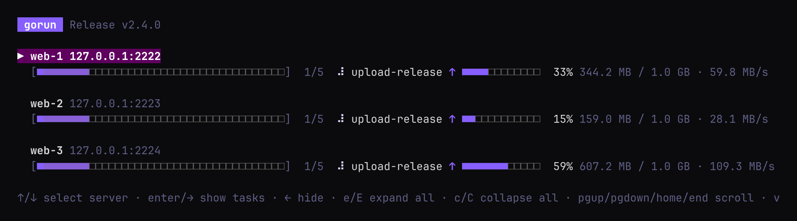

# Tutorial: from hello world to a real deployment

This tutorial builds a Gorunfile one step at a time. It starts with a single task on your own
machine and ends with a file that sets up Ubuntu servers from scratch and runs a web app behind
Caddy, with secrets, retries, health checks and per-region servers. Every task skips itself when
there is nothing to do, and confirms its change when there is.

The finished file is in [`tutorial/`](tutorial/Gorunfile), with its scripts and templates.

**Steps**

1. [Run one task on your machine](#1-run-one-task-on-your-machine)
2. [Add more tasks and put them in order](#2-add-more-tasks-and-put-them-in-order)
3. [Run on real servers](#3-run-on-real-servers)
4. [Send scripts and files](#4-send-scripts-and-files)
5. [Give each server its own settings, and keep secrets out](#5-give-each-server-its-own-settings-and-keep-secrets-out)
6. [Make it reliable](#6-make-it-reliable)
7. [Skip what's already done: check and verify](#7-skip-whats-already-done-check-and-verify)
8. [Name groups of tasks with bundles](#8-name-groups-of-tasks-with-bundles)
9. [Regions, tags and exceptions](#9-regions-tags-and-exceptions)
10. [Splitting large Gorunfiles (optional)](#10-splitting-large-gorunfiles-optional)
11. [Run jobs on a schedule](#11-run-jobs-on-a-schedule)
12. [Share tasks with other Gorunfiles](#12-share-tasks-with-other-gorunfiles)
13. [Upload big files (optional)](#13-upload-big-files-optional)
14. [Everyday use](#14-everyday-use)

You only need gorun [installed](../README.md#install). Steps 1 and 2 run on your own machine;
from step 3 on you need a server you can `ssh` into.

---

## 1. Run one task on your machine

Make a new directory and create a file called `Gorunfile` in it:

```toml
title = "My first Gorunfile"

[tasks.hello]
cmd = "echo hello from $(hostname)"
local = true

[servers]
tasks = ["hello"]

[servers.hosts.local]
```

That is three things:

- a **task** called `hello`, which is just a shell command. `local = true` lets it run on your
  own machine,
- the list of tasks **every server runs** (`[servers] tasks`),
- one **server** called `local`. It has no SSH settings, so it runs on your own machine.

> [!IMPORTANT]
> A server without SSH settings runs **only** tasks marked `local = true`; every other task runs
> only over SSH. Without `local = true`, `local` would run nothing.

Run it:

```bash
gorun Gorunfile
```

A picker opens. Nothing runs until you choose it: press **space** to select `local`, then
**enter** to run. To skip the picker, add `--run`:

```bash
gorun Gorunfile --run
```

## 2. Add more tasks and put them in order

Tasks run one at a time on each server. When a task needs another one to run first, say so with
`depends_on`:

```toml
title = "My first Gorunfile"

[tasks.hello]
description = "Say hello"
cmd = "echo hello from $(hostname)"
local = true

[tasks.make-dir]
description = "Create a scratch directory"
cmd = "mkdir -p /tmp/gorun-demo"
local = true

[tasks.write-file]
description = "Write a file into it"
cmd = "date > /tmp/gorun-demo/last-run"
depends_on = ["make-dir"]
local = true

[servers]
tasks = ["hello", "write-file"]

[servers.hosts.local]
```

- `write-file` depends on `make-dir`, so `make-dir` always runs first, **even though the server
  doesn't list it**.
- `description` is shown in the picker, the live view and the lists.

Check what will run, without running anything:

```bash
gorun Gorunfile --list-tasks      # the tasks, as a dependency tree
gorun Gorunfile --list-servers    # each server and the tasks it will run, in order
```

> [!TIP]
> In the picker, press **→** on a server to see its tasks, and **space** on a task to leave it
> out of this run.

## 3. Run on real servers

A server runs over SSH as soon as it has SSH settings. Replace `[servers.hosts.local]` with your
own servers, and remove `local = true` from the tasks, since tasks marked local never run over SSH:

```toml
[servers.hosts.web-1]
hostname = "web-1.example.com"
    [servers.hosts.web-1.ssh]
    username = "ubuntu"
    identityfile = "~/.ssh/id_ed25519"

[servers.hosts.web-2]
hostname = "web-2.example.com"
    [servers.hosts.web-2.ssh]
    username = "ubuntu"
    identityfile = "~/.ssh/id_ed25519"
```

Repeating the login for every server gets old fast. Put it in a **server group** once, and have
each server join the group:

```toml
[server_groups.app]
    [server_groups.app.ssh]
    username = "ubuntu"
    identityfile = "~/.ssh/id_ed25519"

[servers.hosts.web-1]
hostname = "web-1.example.com"
groups = ["app"]

[servers.hosts.web-2]
hostname = "web-2.example.com"
groups = ["app"]
```

Both servers now run at the same time. If a task fails on one, the rest of **that** server's
tasks are skipped and the other server carries on.

> [!NOTE]
> Anything you leave out (user, port, key, or the real hostname of an alias) is read from
> `~/.ssh/config`.

## 4. Send scripts and files

Commands longer than a line belong in a script. `cmd_file` sends a local script to the server and
runs it there. Paths are relative to the Gorunfile.

```toml
[tasks.docker-install]
description = "Install docker and the compose plugin, if missing"
cmd_file = "./scripts/docker-install.sh"
sudo = true
```

`sudo = true` runs the command with `sudo -n`, so the login user needs passwordless sudo.

To put a file on the server, add a **copy** to a task. Copies run before the task's command, as
the login user and **not** with sudo. So copy to `/tmp` first, then move the file into place in
the command:

```toml
[tasks.caddyfile]
description = "Render the Caddyfile for this server and install it"
cmd = "cp /tmp/myapp.Caddyfile /opt/myapp/Caddyfile"
sudo = true
depends_on = ["app-dirs"]
[[tasks.caddyfile.copy]]
src_template = "./templates/Caddyfile.tmpl"
dst = "/tmp/myapp.Caddyfile"
```

`src_template` is a Go template, rendered separately for each server. `templates/Caddyfile.tmpl`:

```
{{.Hostname}} {
	reverse_proxy app:{{.vars.port}}
{{- range .vars.redirects}}
	redir {{.from}} {{.to}}
{{- end}}
}
```

On `web-eu-1` that becomes:

```
eu-1.example.com {
	reverse_proxy app:8080
	redir /docs https://docs.example.com
}
```

A template sees the server it is rendered for — `{{.Name}}`, `{{.Hostname}}`, `{{.Tags}}` and
`{{index .EnvVars "NAME"}}` — plus the task's own **`vars`**.

**vars: what the template needs that isn't the server.** `{{.Hostname}}` answers *which server is
this?* It cannot answer *what port does the app listen on?* or *which redirects should this site
add?* Those belong to the task: they are the same on every host that runs it, and they have
nothing to do with the server's identity. Put them in `[tasks.<name>.vars]`:

```toml
[tasks.caddyfile.vars]
port = 8080

[[tasks.caddyfile.vars.redirects]]
from = "/docs"
to = "https://docs.example.com"
```

A value in `vars` can be a string, a number, a boolean, a nested table, or a list of tables (the
`[[tasks.caddyfile.vars.redirects]]` blocks above), so a template can loop over a whole structure
with `range`. Inside a `range`, `.` is the item being looped over, and `$` still refers to the
whole template data — so `{{$.vars.port}}` reaches the port from inside the loop.

**Which one do I want?** The three overlap, and picking the wrong one is the usual source of
confusion:

| Put it in | When | Read it as |
|---|---|---|
| the server | the value comes from the host: name, hostname, tags | `{{.Hostname}}`, `{{.Tags}}` |
| `envvars` | the **command** needs it (`$APP_VERSION`), it is a secret, or it differs per server or group | `$APP_VERSION` in the command, `{{index .EnvVars "APP_VERSION"}}` in a template |
| `vars` | only a template needs it, and it is the same wherever the task runs | `{{.vars.port}}`, `{{range .vars.redirects}}` |

That is why `docker-compose.yml.tmpl` reads `{{index .EnvVars "APP_VERSION"}}` and not a var: the
image tag differs between production and staging, and staging overrides it in
[section 5](#5-give-each-server-its-own-settings-and-keep-secrets-out). A task's `vars` cannot
differ per server — they belong to the task — so a per-server value has to go in `envvars`
instead, or in the **server's** own `vars` (read as `{{.Server.Vars.KEY}}`), which merge the same
way envvars do: global, then group, then host.

The other kinds of copy: `src` copies a file, or a whole directory, as it is, and `content` writes
inline text. `src_template` is rendered; `src` and `content` are copied literally. A destination
that differs per server can be a template too: `dst_template = "{{.Server.Vars.app_dir}}/Caddyfile"`.
The same goes for checks, verifies and envvars (`check_template`, `verify_template`,
`envvars_template`); see [templates](gorunfile.md#templates).

## 5. Give each server its own settings, and keep secrets out

`envvars` are exported to every task's command. Set them on a group, and override them on a
server:

```toml
[server_groups.app]
envvars = { APP_ENV = "production", APP_VERSION = "1.4.2" }

[servers.hosts.staging]
hostname = "staging.example.com"
groups = ["app"]
envvars = { APP_ENV = "staging", APP_VERSION = "1.5.0-rc1" }   # the server wins over its groups
```

Templates see them too, so the compose file can pick each server's image tag:

```yaml
    image: ghcr.io/example/myapp:{{index .EnvVars "APP_VERSION"}}
```

**Secrets never go in the Gorunfile.** Write `${NAME}` and gorun fills it in from your
environment when it runs:

```toml
[tasks.registry-login]
cmd_file = "./scripts/registry-login.sh"
sudo = true
depends_on = ["docker-enable"]
[tasks.registry-login.envvars]
REGISTRY_USER = "${REGISTRY_USER}"
REGISTRY_TOKEN = "${REGISTRY_TOKEN}"
```

Set them in your shell, or in a `.env` file in the directory you run gorun from (and keep that
file out of git):

```bash
REGISTRY_USER=me
REGISTRY_TOKEN=ghp_...
```

The values are sent to the task over stdin, so they don't show up in gorun's logs, the run
history or the server's process list.

## 6. Make it reliable

Real servers are slow, flaky and sometimes still booting. Three settings help:

```toml
[tasks.docker-install]
description = "Install docker and the compose plugin, if missing"
cmd_file = "./scripts/docker-install.sh"
sudo = true
rerun = "safe"        # running it again is harmless
timeout = "20m"       # the default is 30m
retries = 2           # up to three attempts in total
retry_delay = "15s"   # wait between attempts
```

- **`timeout`**: a task that runs too long fails with exit code 124, so one hung server can't
  hold up the run.
- **`retries`**: try again after a failure, for things like apt locks or network blips.
- **`rerun`**: `safe` means the task can run again without harm. Mark a task `unsafe` if it
  isn't; it then shows ⚠ and is never retried automatically.

Make your tasks safe to rerun wherever you can. Then fixing a failed deploy is just running the
same command again. The [next step](#7-skip-whats-already-done-check-and-verify) makes reruns
cheap too: each task finds out first whether there is anything to do.

Add **health checks**: tasks that only read the server, so you can ask "is everything OK?" at any
time:

```toml
[tasks.health-containers]
description = "Check the app and caddy containers are running"
cmd = "cd /opt/myapp && test $(docker compose ps --status running --quiet | wc -l) -eq 2"
sudo = true
rerun = "safe"
retries = 3
retry_delay = "5s"
```

Health checks don't `depends_on` any setup task, so running them never changes anything.

## 7. Skip what's already done: check and verify

Running the whole file again reinstalls nothing, because each script looks first. But that
looking is hidden inside the scripts, so every task shows as *ok* whether it changed anything or
not, and a change that silently didn't take still shows *ok*. Two keys bring it into the open:

- **`check`** runs before the task. Exit 0 means *nothing to do*: the task is marked
  **unchanged** (`=`) and its copies, command and verify are skipped. Any other exit code runs
  the task.
- **`verify`** runs after the command. A non-zero exit fails the task, so "it ran" becomes "it
  worked".

```toml
[tasks.docker-install]
description = "Install docker and the compose plugin, if missing"
check = "command -v docker && docker compose version"    # exit 0: already installed
cmd_file = "./scripts/docker-install.sh"
verify = "docker compose version"
sudo = true

[tasks.docker-enable]
check = "systemctl is-enabled --quiet docker && systemctl is-active --quiet docker"
cmd = "systemctl enable --now docker containerd"
verify = "systemctl is-active --quiet docker"
sudo = true
```

The `if docker is installed then exit` at the top of `docker-install.sh` can go: the check does
that now, and shows it. A check is just a command, so write it the way you would test by hand:
`test -d`, `grep -q`, `systemctl is-active`, `curl -fs`.

**Copies can check themselves.** `check_copies = true` compares the MD5 of each file a task would
copy, a rendered template included, with the one already on the server. The server hashes its own
file with `md5sum`, `md5 -r` or `openssl`, so only the hashes cross the network. When everything
matches, nothing is copied and the command doesn't run. With a `check` as well, the task is
unchanged only when both say so:

```toml
[tasks.caddyfile]
description = "Render the Caddyfile for this server and install it"
check_copies = true                                        # the staged copy is up to date
check = "cmp -s /tmp/myapp.Caddyfile /opt/myapp/Caddyfile" # and it is the one installed
cmd = "cp /tmp/myapp.Caddyfile /opt/myapp/Caddyfile"
sudo = true
depends_on = ["app-dirs"]
[[tasks.caddyfile.copy]]
src_template = "./templates/Caddyfile.tmpl"
dst = "/tmp/myapp.Caddyfile"
```

If a server has no MD5 tool, the comparison is skipped and the files are copied, so it never
fails a run.

**Some tasks should always run.** Leave out `check` and `check_copies` and the task runs every
time, as before. `registry-login` has no check, so a rotated token is always picked up, and
`compose-up` always runs `docker compose up`, which does nothing when nothing changed. It gets a
`verify`, so a stack that didn't come up fails the deploy instead of passing it:

```toml
[tasks.compose-up]
cmd_file = "./scripts/compose-up.sh"
verify = "cd /opt/myapp && test $(docker compose ps --status running --quiet | wc -l) -eq 2"
```

Two flags go with it:

```bash
gorun Gorunfile --run --check   # dry run: run only the checks, and say what would change
gorun Gorunfile --run --force   # skip the checks and run every task anyway
```

`--check` changes nothing: each task ends as *would run* (`~`) or *unchanged* (`=`), and the run
is marked *check only* in history. History also keeps each check's and verify's command, exit
code and output, in their own drop-downs next to the task's stdout and stderr.

> [!NOTE]
> A check that can't run at all (it times out, or the connection drops) fails the task rather
> than guess. A failing verify fails the task with the verify's exit code, and retries run the
> check again first.

See [checks](gorunfile.md#checks-run-only-when-needed) for every rule.

## 8. Name groups of tasks with bundles

The file now has about a dozen tasks. A **bundle** names a list of them, and you use it anywhere a
task name goes, as `@name`:

```toml
[bundles.docker]
description = "Docker installed, running and logged in"
tasks = ["docker-install", "docker-enable", "registry-login"]

[bundles.files]
description = "The app's directories and config files"
tasks = ["app-dirs", "caddyfile", "compose-file"]

[bundles.deploy]
description = "Set up a server from scratch and start or update the stack"
tasks = ["@docker", "@files", "compose-up"]      # bundles can include bundles

[bundles.health]
description = "Read-only health checks of a deployed server"
tasks = ["health-docker", "health-containers", "health-https"]
```

Now the group says what every app server does, in one line:

```toml
[server_groups.app]
tasks = ["@deploy", "@health"]
```

And you can run just part of it from the command line:

```bash
gorun Gorunfile --run --task @health    # only the health checks, change nothing
gorun Gorunfile --list-bundles          # what each bundle expands to
```

## 9. Regions, tags and exceptions

**Tags** label servers so you can pick them out (`--tag eu`, or in the picker). A server gets the
tags of its groups plus its own. A group with nothing but `tags` is an easy way to label a region:

```toml
[server_groups.eu]
tags = ["eu"]

[server_groups.us]
tags = ["us"]

[servers.hosts.web-eu-1]
hostname = "eu-1.example.com"
groups = ["app", "eu"]

[servers.hosts.web-us-1]
hostname = "us-1.example.com"
groups = ["app", "us"]
```

When one server needs something different, change just that server:

```toml
[servers.hosts.staging]
hostname = "staging.example.com"
groups = ["app"]
tags = ["staging"]
skip_tasks = ["health-https"]     # no public certificate here
```

| On a server | Does |
|---|---|
| `add_tasks = [...]` | runs these as well |
| `skip_tasks = [...]` | leaves these out (bundles work too: `["@health"]`) |
| `tasks = [...]` | replaces the list completely |

`gorun Gorunfile --list-servers` shows the final task list of every server, so you can see the
effect before you run anything.

**That's the whole file.** Read it end to end in [`tutorial/Gorunfile`](tutorial/Gorunfile).

## 10. Splitting large Gorunfiles (optional)

As your Gorunfile grows, you can split it across multiple files with `include`:

```toml
include = [
  "tasks/*.toml",            # shared tasks and bundles
  "groups/*.toml",           # server groups
  "hosts/*/*.toml",          # one folder per role, one file per fleet
]
```

Files are merged into one config, so you can use names from any of them. This keeps large inventories
organized and makes it easy to manage by role or region.

For a complete example, see [`recipes/large-inventory`](../recipes/large-inventory).

## 11. Run jobs on a schedule

A `[[schedule]]` table runs a target, a task or a `@bundle`, on a cron pattern or once at a set
time. Schedules run inside the web service, `gorun -web`, not in a plain run. Add these to the
file:

```toml
[[schedule]]
name = "nightly-health"
description = "Read-only health checks every night"
target = "@health"
cron = "0 2 * * *"                # minute hour day month weekday
timezone = "Australia/Sydney"     # the clock the fields are read in; omit for UTC
missed = "skip"                   # or "run": one catch-up run for runs missed while paused or down

[[schedule]]
name = "maintenance"
target = "@deploy"
at = "2026-12-01T02:00"           # a one-off time, read in the timezone above
timezone = "Europe/London"
```

Set `cron` or `at` on each schedule, not both. A bad schedule stops gorun with a message that
names it, when the file loads.

Start the web service with the file and open the **Schedules** page:

```bash
gorun -web Gorunfile
```

The page lists each schedule with its next run, in your browser's time zone (change it with the
picker). **Pause**, **Resume** and **Skip next run** act on one schedule. **Add a schedule** and
**Edit** write straight to the file, and every run, skipped run and failed run shows in
**History**. The web service starts its own NATS server if none is running, so live updates work
without setup.

A scheduled run goes to every server, as `--task` does, so a task has to suit each server it
reaches. A task that isn't `local = true` cannot run on a local server, and that run fails with
the reason in History.

The [scheduled jobs recipe](../recipes/05-scheduled-jobs/README.md) runs these schedules on your
own machine, and [Schedules](schedules.md) has the full syntax.

## 12. Share tasks with other Gorunfiles

The tasks you wrote here — Docker, the Caddyfile, the health checks — would be useful in other projects
too. Instead of copying them, move them into a git repository of their own and include them.

1. Make a repository, say `deploy-tasks`, with the task and bundle tables and their scripts:

   ```
   deploy-tasks/
     docker.toml       # [tasks.docker-install], [tasks.docker-enable], [bundles.docker]
     health.toml       # [tasks.health-docker], [tasks.health-containers], [bundles.health]
     scripts/docker-install.sh
   ```

   A library task's `cmd_file` is relative to the root of its repository, so `docker-install` keeps
   `cmd_file = "scripts/docker-install.sh"`. Move a task's `depends_on` tasks into the library with
   it, so the library works on its own; your Gorunfile adds its own steps around the library's
   bundles in a server's `tasks` list. Servers, groups and global `envvars` stay in your
   Gorunfile, and secrets stay in the environment as before: a library may only hold tasks and
   bundles.

2. Tag a version and push it: `git tag v1.0.0 && git push --tags`.

3. Replace the tasks in your Gorunfile with an include, pinned to that tag:

   ```toml
   include = ["git::https://github.com/you/deploy-tasks.git//*.toml?ref=v1.0.0"]
   ```

   Over SSH it is `git::git@github.com:you/deploy-tasks.git//*.toml?ref=v1.0.0`. Your git
   credentials are used, so private repositories work the same way.

4. Run `gorun Gorunfile --list-bundles` to check the bundles arrived. The first run fetches the
   library and writes `Gorunfile.lock` next to your Gorunfile, with the exact commit it used. Commit
   that file: from now on every run uses that commit, even if someone moves the tag.

To take a newer version, change `?ref=` or move the tag, then run
`gorun Gorunfile --update-includes`. It looks the refs up again, updates the lock file and prints
the commits.

The [task library recipe](../recipes/06-task-library/README.md) does this with a small library you
can run on your own machine. [Tasks from a git repository](gorunfile.md#tasks-from-a-git-repository)
has every rule.

## 13. Upload big files (optional)

Servers that can't reach your registry need the app's image brought to them. Save it to a file
and copy it like any other file; gorun streams it, so a few gigabytes is fine. This step isn't in
the finished `tutorial/Gorunfile`, because it needs an image file to exist first.

```bash
docker save myapp:2.4.0 -o build/myapp-image.tar
```

```toml
[tasks.app-image]
description = "Ship the app's image to servers that can't reach the registry"
check = "docker image inspect myapp:2.4.0 >/dev/null"   # already loaded: don't upload it again
cmd = "docker load -i /tmp/myapp-image.tar && rm /tmp/myapp-image.tar"
sudo = true
depends_on = ["docker-install"]
[[tasks.app-image.copy]]
src = "./build/myapp-image.tar"
dst = "/tmp/myapp-image.tar"
```

Run it, and each server shows its upload as it goes: the percentage, how much has been sent and
how fast. Slow links are easy to spot, because their bars fall behind:

```bash
gorun Gorunfile --run --task app-image
```



Press **v** for a row per task, with its own bar. `gorun -web` shows the same under the running
task, and `--plain` prints a line about every 10%, so CI logs show it too. Ctrl-C stops the
uploads where they are. See [upload progress](gorunfile.md#upload-progress) for the details.

The `check` matters most here: without it, every run would send the whole image again. The
check asks the server whether the image is already loaded, so a rerun costs one command, not
gigabytes. (`check_copies` wouldn't help, because the command deletes the tar once it is loaded.)

> [!TIP]
> Copying a whole directory (`src = "./build/site"`) shows one bar for all of it, counting every
> file.

## 14. Everyday use

```bash
gorun Gorunfile                                    # pick servers and tasks, then run
gorun Gorunfile --run                              # deploy every server: only what changed
gorun Gorunfile --run --check                      # dry run: what would change
gorun Gorunfile --run --force                      # run every task, even ones already done
gorun Gorunfile --run --server web-eu-1            # one server
gorun Gorunfile --run --tag us                     # every server tagged us
gorun Gorunfile --run --task @health               # only the health checks
gorun Gorunfile --run --task compose-up --tag eu   # redeploy the stack in the EU
gorun -history                                     # look back at past runs
```

> [!CAUTION]
> `--task X` runs X on **every** selected server, even ones that don't normally run it. Aim it
> with `--server`, `--tag` or `--group`.

**Where next**

- [The Gorunfile](gorunfile.md): every option, explained.
- [Running gorun](running.md): the picker, the live view, filters and history.
- [Reference](reference.md): all flags, keys, environment variables and shortcuts on one page.
