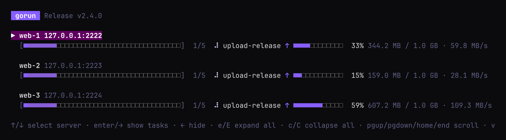

# Recipe 7: big uploads

Uploads a 1 GB release and a 200-file static site to three lab servers, and shows how far each
upload has got: a bar, the percentage, the bytes sent and the speed.

## Run it

Start the lab first (see [the recipes README](../README.md)), then make the files to upload. They
go in `build/`, which git ignores:

```sh
recipes/07-big-upload/make-files.sh              # build/release.tar.gz is 1 GB
SIZE_MB=4096 recipes/07-big-upload/make-files.sh # or 4 GB, for a longer upload
```

Then run it:

```sh
gorun recipes/07-big-upload/Gorunfile -r         # the live view
gorun recipes/07-big-upload/Gorunfile -r -v      # a row and a bar per task
gorun recipes/07-big-upload/Gorunfile -r --plain # plain lines, as in CI
gorun -web recipes/07-big-upload/Gorunfile       # the web UI: tick the servers and run
```



The lab's servers are containers on your machine, so uploads are much faster than over a real
network: the bars may finish in a second or two. Use a bigger `SIZE_MB` to watch them for longer.

## What it shows

| Task | Copy | Shows |
|---|---|---|
| `upload-release` | `build/release.tar.gz`, one large file | one bar for the file, then the small checksum file |
| `upload-site` | `build/site`, a folder | one bar for the whole folder, counting every file |
| `verify` | — | `sha256sum -c` on the server: the release arrived whole |

- **Ctrl-C** (or **Stop** in the web UI) stops the uploads part way. Run it again to start over.
- `--plain` prints a line as each large copy starts, about every 10%, and when it is done:

  ```
  server1: upload-release sending release.tar.gz (1.0 GB)
  server1: upload-release sending release.tar.gz 10% (102.4 MB / 1.0 GB · 59.8 MB/s)
  ...
  server1: upload-release sent release.tar.gz (1.0 GB in 17.1s, 59.9 MB/s)
  ```

- `gorun recipes/07-big-upload/Gorunfile -r --task cleanup` removes `/tmp/gorun-upload` from the
  servers.

See [upload progress](../../docs/gorunfile.md#upload-progress) for how it works, and
[`CopyProgressEvent`](../../docs/history.md#copyprogressevent-copy_progress) to show it in your own
program.
